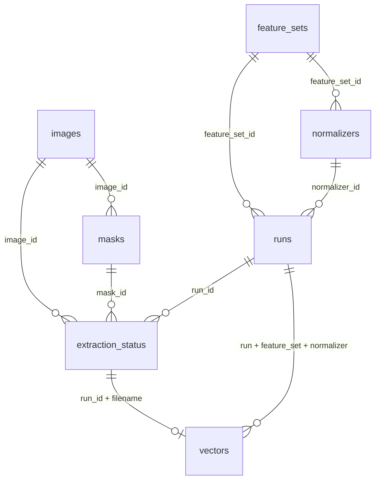

# Yêu cầu 3 — Trích xuất B400 và CSDL quản trị đặc trưng

Triển khai trên Mac Intel/Python 3.10.11, CPU, dùng NumPy 1.26.4, Pillow 12.3.0,
OpenCV 4.11.0 và SQLite 3.40.1 của Python. Không thêm phụ thuộc, không cần scikit-image,
không đổi hai tệp requirements. Không chạy lại GrabCut/U²-Net hoặc sửa dữ liệu
nguồn. Bộ 317 mask U²-Net trong hồ sơ lịch sử không được dùng.

## Kiến trúc và đầu vào

- [`inputs.py`](../../tools/features/inputs.py): kiểm tra chỉ đọc hiện trạng, độc lập
  với verifier GrabCut cũ; không yêu cầu mtime hoặc trạng thái `chua_duyet`.
- [`b400.py`](../../tools/features/b400.py): trích xuất thuần từ RGB/mask, tên chiều,
  phiên bản/cấu hình, fit scaler và biến đổi bằng scaler cố định.
- [`storage.py`](../../tools/features/storage.py): schema SQLite, giao dịch nhập/
  cập nhật, đọc vector theo ảnh và lần chạy, kiểm kê trạng thái.
- [`cli.py`](../../tools/features/cli.py): điều phối validate/extract/verify/init/
  status/get; khóa ghi để không có hai lần ghi đồng thời cùng thư mục.

Kiểm tra tập tên của ảnh hiện có, manifest phân đoạn và CSV kiểm kê yêu cầu 2;
bao gồm cả ảnh thiếu hoặc thừa trong từng nguồn. Mỗi tên có đúng một dòng
manifest, đường dẫn tương đối an toàn, không symlink/thoát cây, mask không được
chia sẻ giữa hai ảnh. Tìm thêm mask PNG không có tham chiếu. Đọc đường dẫn mask
trực tiếp từ manifest, gồm đuôi `.jpg.png`, không suy tên từ stem.

Giải mã đầy đủ JPEG RGB một frame 576×384 và PNG mask grayscale nhị phân 0/255,
cùng kích thước; tiền cảnh phải khác rỗng/toàn ảnh. SHA-256 ảnh phải khớp cả
manifest phân đoạn và CSV kiểm kê hiện hành; SHA-256 mask khớp manifest. Kiểm tra
kích thước, số pixel, diện tích và tỉ lệ mask đã ghi. Kế thừa đúng quyết định
`success/da_duyet/dat`; giữ `suspicious`, `review_flags`, số thành phần lịch sử
trong metadata, không dùng cờ để đổi quyết định. Chỉ kiểm tra đường dẫn overlay
hiện diện, không yêu cầu `accepted/` và không tính đặc trưng từ overlay.

`input_validation.json` ghi từng tên/lý do sai lệch, hash manifest và CSV kiểm kê.
Trước trích xuất từng ảnh, kiểm lại hash bytes được giải mã; sau toàn bộ quá trình,
kiểm tra lại cả tập đầu vào. Nếu thay đổi trong lúc chạy, không xuất vào CSDL.

## Định nghĩa 400 giá trị

Giữ tên B400 và đường dẫn `outputs/features/b400_v1/`; ngày 21/10/2026 đã tính
lại nội dung theo S2e/S3 mới. Vector/scaler cũ không tương đương vector/scaler
hiện hành. S2/S3 có revision khối 2, các khối khác vẫn 1; không tạo bộ B400 mới.
`feature_set.json` lưu đầy đủ 400 tên chiều, công thức, hash mã/runtime và thứ tự;
NPZ lưu cùng tên. Dtype vector lưu trữ là little-endian float32 (`<f4`). Tính nội
bộ bằng float64 rồi chuyển một lần sang float32.

| Khối | Chỉ số Python | Chiều | Thứ tự bên trong |
|---|---|---:|---|
| C1 | `[0:32]` | 32 | HSV H16, S8, V8 |
| C2 | `[32:48]` | 16 | Lab a8, b8 |
| T1 | `[48:68]` | 20 | LBP R=1 rồi R=3, mỗi bán kính 10 bin |
| T2 | `[68:100]` | 32 | d=1,3; góc 0,45,90,135; energy/contrast/homogeneity/correlation |
| T3 | `[100:148]` | 48 | f=0.08,0.16,0.24; góc 0,45,90,135; bandwidth=1,2; mean/std |
| S1 | `[148:155]` | 7 | Hu h1…h7 signed-log |
| S2 | `[155:160]` | 5 | aspect, extent, solidity, circularity, axis_ratio (S2e tại 159) |
| S3 | `[160:208]` | 48 | Bit lưới mask 6 hàng × 8 cột, theo hàng rồi cột |
| S4 | `[208:272]` | 64 | 32 biên trên rồi 32 biên dưới |
| P | `[272:400]` | 128 | Lưới 2 hàng × 4 cột, mỗi ô H8/S4/V4 |

### Canvas và màu

Bbox bao toàn bộ pixel tiền cảnh, giữ mọi thành phần liên thông. Co cùng một
hệ số `min(288/w,192/h)`; làm tròn kích thước về số nguyên gần nhất, ít nhất 1
pixel; đặt giữa canvas 288×192 cho các khối hiện hữu trừ S3. S2e đo trực tiếp
mask nguồn trước resize. S3 có canvas riêng mô tả bên dưới.
Không xoay ảnh EXIF hoặc biến đổi ICC.
Mask resize nearest-neighbor. RGB resize tuyến tính theo
`resize(RGB×mask)/resize(mask)` để pixel nền không pha vào tiền cảnh. Trường hợp
nearest mask chọn pixel tiền cảnh mà tổng trọng số tuyến tính bằng 0 dùng RGB
nearest từ pixel tiền cảnh đó; đếm riêng số pixel này trong metadata. RGB làm
tròn/clamp uint8 trước chuyển màu. Lưu bbox, hệ số, kích thước, độ đệm và số
thành phần nguồn/canvas trong metadata; nearest có thể làm mất chi tiết dưới
một pixel, không tự giữ riêng thành phần lớn nhất.

HSV/Lab theo OpenCV uint8; H∈[0,180), S/V/a/b∈[0,256). Histogram mỗi kênh chia
L1; hue có trọng số S/255 và làm trơn vòng bằng `[1,2,1]/4` trước chia L1.
Chỉ lấy pixel tiền cảnh. Lưới chia bằng `numpy.array_split`, theo hàng rồi cột.
Histogram thô đã L1; vector chuẩn hóa mới căn từng bin.

### Kết cấu và cách giới hạn vùng hợp lệ

LBP dùng P=8, uniform bất biến xoay, R=1 và R=3. Lấy mẫu tròn bằng nội suy
bilinear; tâm và **mọi pixel có trọng số nội suy dương** phải trong mask và
canvas. Lân cận ≥ tâm cho bit 1 (tolerance số học 10⁻⁹ mức xám); ≤2 chuyển bit
vòng cho bin bằng số bit 1 (0…8), còn lại bin 9. Histogram L1 trên tâm hợp lệ.

GLCM lượng tử `gray_uint8//4` thành 64 mức. Với từng d/góc lấy
`dx=round(d cosθ), dy=round(d sinθ)`, y tăng xuống dưới; riêng d=3 ở 45° có
offset (2,2). Chỉ đếm cặp có hai đầu trong mask, cộng ma trận chuyển vị rồi
chia tổng. Energy=√Σp²; contrast=Σp(i−j)²; homogeneity=Σp/[1+(i−j)²]; correlation
là hiệp phương sai chia tích độ lệch chuẩn hai biên. Phương sai ≤10⁻¹⁵ được
đánh dấu không xác định. Metadata giữ số cặp trước cộng đối xứng.

Thiết kế yêu cầu 2 ghi 48 chiều Gabor nhưng 3 tần số × 4 hướng × 2 thống kê
chỉ có 24. Quyết định v1 thêm **hai bandwidth cố định `{1,2}` octave**, tạo
24 kernel phức × mean/std biên độ = 48. Không sao chép 24 giá trị để đủ chiều.
Giữ tần số/hướng/`n_stds=2` của thiết kế; quyết định này chưa được tối ưu truy hồi.

Với mỗi bandwidth b và tần số f,
`σx=σy=√(ln2/2)/π × (2^b+1)/(2^b−1)/f`. Kernel là Gaussian phức nhân sóng
`exp(2πif x_rot)`, chia `2πσ²`, phase 0, không trừ DC. Cửa sổ chữ nhật theo
hai lần độ lệch chuẩn sau xoay, làm tròn lên, như công thức
[scikit-image 0.24 Gabor](https://github.com/scikit-image/scikit-image/blob/v0.24.0/skimage/filters/_gabor.py).
Dùng OpenCV filter2D cho phần thực/ảo, lấy magnitude trên xám/255; chỉ thống kê
tâm mà **toàn bộ cửa sổ chữ nhật** nằm trong tiền cảnh. Vì lấy magnitude, đổi
convolution thành correlation không đổi đại lượng đo của kernel đối xứng này.
Độ lệch chuẩn dùng mẫu số N. Metadata ghi số tâm hợp lệ cho từng kernel.
Các định nghĩa GLCM/LBP tham khảo
[tài liệu chính thức scikit-image](https://scikit-image.org/docs/0.24.x/api/skimage.feature.html);
phần giới hạn mask và quy ước thiếu là quyết định cụ thể của triển khai này.

### Hình dạng và vùng không có phép đo

Hu từ moments mask nhị phân trên canvas, bao mọi thành phần và lỗ;
`h=0→0`, còn lại `−sign(h) log10(max(|h|,10⁻¹²))`. Aspect w/h lấy bbox nguồn
trước đệm. Extent, solidity và circularity đo canvas 288×192 bằng quy ước raster nhất quán:
A là số pixel tiền cảnh; extent=A/(w×h) với bbox canvas; A_hull là số pixel của
convex hull tô kín bao tâm mọi pixel; P là tổng cạnh pixel lộ ra, gồm biên lỗ;
circularity=4πA/P². Các công thức này không thay đổi.

**S2e (`S2_axis_ratio`, một chiều):** `major_length/minor_length`, đo trên mask
nguồn trước resize, không dùng PCA hoặc tỉ lệ trị riêng covariance. Tọa độ là
tâm pixel nguyên `(x=cột,y=hàng)`, gốc trên trái, y tăng xuống; độ dài theo
đơn vị pixel, không cộng 1 vào khoảng cách. Lấy convex hull của tâm mọi pixel
tiền cảnh: các đỉnh là điểm biên, giữ cả thành phần rời; đường kính và cực trị
phép chiếu của hull bằng của toàn đường bao.

Trục chính nối hai đỉnh có khoảng cách Euclid lớn nhất. So sánh khoảng cách
bình phương bằng số nguyên; nếu nhiều cặp hòa, sắp hai đầu theo `(x,y)` rồi
chọn cặp nhỏ nhất theo thứ tự từ điển. Trục phụ đo bề rộng bao đủ hình theo
phương vuông góc: với `d=(dx,dy)`, `L=|d|`, lấy
`minor=(max cross(d,p−a)−min cross(d,p−a))/L`. Không dùng trục phụ đi qua
trọng tâm để thay thế bề rộng này. Hình chữ nhật có trục chính là đường chéo;
tỉ lệ này không đồng nhất w/h bbox, cũng không bị chặn trong [0,1].
Một tâm pixel hoặc hình thẳng hàng có trục chính/bề rộng bằng 0: raw=0,
validity=false, lý do `undefined_axis_ratio_zero_major` hoặc
`undefined_axis_ratio_zero_minor`. `quality.s2e` lưu hai đầu trục chính, độ dài
hai trục, cực trị phép chiếu, cross span và trạng thái hợp lệ; không tạo tỉ lệ giả.

**S3 (48 bit raw):** bbox bao toàn bộ tiền cảnh mask nguồn; co cùng một hệ số
`min(256/w,192/h)`; round kích thước gần nhất (hòa về số chẵn), ít nhất 1 pixel;
nearest-neighbor, đệm 0 vào giữa canvas **256×192**, offset floor. Làm tròn
kích thước chỉ gây sai số raster, không co riêng hai trục để kéo giãn con vật.
Lưới **6 hàng × 8 cột**, mỗi ô vuông **32×32=1024 pixel**, gồm cả đệm;
đọc trái sang phải rồi trên xuống dưới. `r=foreground_count/1024`,
`bit=1 nếu r>0.15, ngược lại 0`, triển khai so nguyên `20*count>3*1024`.
Đúng 15% cho 0; với ô 1024 pixel, 153 cho 0 và 154 cho 1 (không có số pixel
nguyên đạt đúng 15%, nên kiểm thử riêng 3/20). `quality.s3` lưu 48 occupancy
trước ngưỡng, counts, diện tích ô, bbox, scale, resized và offset.
Bit 0 có thể là ô trống **hoặc có không quá 15% tiền cảnh**, đều là phép đo hợp lệ.

Canvas 256×192 và lưới 6×8 là lựa chọn của nhóm để giữ 48 chiều, không do bài
giảng quy định. Repo không có PDF bài giảng nên **chưa đối chiếu được bản PDF**;
dùng định nghĩa đã giao: ngưỡng trên 15%, hai điểm xa nhất, trục phụ vuông góc
bao đủ hình, tỉ lệ độ dài. Chưa chuẩn hóa xoay hoặc đặt trục chính dài 192;
chỉ áp dụng hai thay đổi S2e/S3, không tuyên bố đủ quy trình slide.

S4 giữ nguyên, chia trục x canvas 288×192
thành 32 dải, biên trên=min_y/192, biên dưới=(max_y+1)/192 trên mọi tiền cảnh
của dải; lưu thêm số pixel occupancy mỗi dải trong metadata.

Để vector cố định mà không giả định dữ liệu thiếu là phép đo hợp lệ:

| Tình huống | Quy ước trong vector | Metadata ngoài 400 chiều |
|---|---|---|
| Ô histogram hoặc dải profile trống | raw=0 | validity=false, `empty_cell`/`empty_profile_strip`, occupancy |
| Hue tổng saturation bằng 0 | raw=0 | validity=false, `zero_hue_saturation` |
| Không có tâm LBP/Gabor hoặc cặp GLCM hợp lệ | raw=0 | validity=false, lý do thiếu hỗ trợ, số mẫu |
| Correlation hoặc mẫu số hình học không xác định | raw=0 | validity=false, lý do cụ thể |
| Hu bằng 0, histogram có bin 0, bit S3 bằng 0 | Giá trị đo hợp lệ | validity=true; S3 có thể có occupancy ≤15% |
| Mask rỗng/toàn ảnh, không nhị phân, lệch kích thước/hash hoặc NaN/Inf | Không tạo vector | status=failed, tên và lý do |

`validity` có 400 phần tử, lưu riêng trong NPZ/SQLite; không nối vào B400.
`quality.conventions` ghi chỉ số `[start,stop)` và lý do. Trích xuất thành công
có thể chứa giá trị quy ước; thống kê riêng số ảnh như vậy, không gọi tất cả
phép đo của ảnh là hợp lệ.

## Chuẩn hóa và dùng lại ở yêu cầu 4

1. Các histogram C1/C2/T1/P đã L1 trong raw; lấy căn bậc hai từng bin.
2. T2/T3/S1/S2/S3/S4: z-score theo từng chiều, fit mean/std quần thể chỉ từ
   các giá trị validity=true. Chiều không có quan sát dùng mean=0, scale=1;
   std≤10⁻¹² dùng scale=1. Lưu count, mean, scale và cờ constant cho mọi chiều.
   Không clipping; sau biến đổi đặt chiều validity=false về 0.
   S3 raw vẫn là bit; sau z-score/L2 giá trị có thể không còn 0 hoặc 1.
   Scaler đã được fit lại trên toàn bộ vector mới, không tái sử dụng scaler cũ.
3. L2 mỗi khối con: C1/C2; T1/T2/T3; S1/S2/S3/S4; tám ô P. L2 lại mỗi nhóm
   màu/kết cấu/hình dạng/bố cục để cân bằng nội nhóm.
4. Mỗi nhóm có trọng số khoảng cách 1/4, nhân hệ số √(1/4)=1/2, nối theo
   thứ tự rồi L2 cuối. Norm 0 giữ 0; không chia cho 0. Nhóm không có dữ liệu
   vẫn 0; L2 cuối phân bổ lại norm cho các nhóm có thông tin.

Fit trên tất cả ảnh thành công của **tập phát triển hiện hành**, mỗi ảnh một
trọng số, không nhãn/tên tệp trong phép tính hoặc quyết định trọng số. Đây không
phải chia train/test hoặc kết quả đánh giá truy hồi. Nhãn và tên chỉ phục vụ
quản trị, kiểm kê và nối đúng bản ghi.

`normalizer.json` và bảng `normalizers` lưu đầy đủ quy tắc, tham số, trọng số,
count quan sát, hash cấu hình và digest đầu vào; ID là SHA-256 nội dung. Hàm
`extract_normalized` không fit lại, kiểm tra cấu hình và checksum scaler:

```python
import json
from tools.features.b400 import extract_normalized
params = json.load(open('outputs/features/b400_v1/normalizer.json'))
raw, normalized, validity, quality = extract_normalized(rgb_uint8, mask_0_255, params)
```

Giữ hướng ảnh đầu vào. Yêu cầu 4 phải áp dụng cùng công thức cho truy vấn gốc
và lật ngang (cả ảnh/mask), dùng min khoảng cách cho mọi ảnh, không suy hướng
từ nhãn. Chưa xây truy vấn hoặc giao diện trong yêu cầu 3.

## CSDL SQLite thực tế

Vị trí: [`outputs/features/b400_v1/features.sqlite3`](../../outputs/features/b400_v1/features.sqlite3).
SQLite lưu cả raw/normalized `<f4` 400 chiều (mỗi BLOB 1.600 bytes) và validity
400 bytes. Tham số JSON và metadata lưu UTF-8. Đường dẫn ảnh/mask tương đối từ
root dự án; không lưu đường dẫn tuyệt đối của máy trong CSDL.



| Bảng | Khóa và nội dung |
|---|---|
| images | id; UNIQUE(path,sha256); filename, nhãn metadata, kích thước |
| masks | id; image_id FK; path/hash/pixels; UNIQUE(image_id,path,sha256) |
| feature_sets | ID từ hash cấu hình, mã và runtime; tên, dimensions=400, dtype, JSON chứa tên/thứ tự/phiên bản khối |
| normalizers | ID từ hash tham số; feature_set_id FK; toàn bộ tham số JSON |
| runs | ID từ hash bộ thuộc tính + digest kiểm tra đầu vào; feature_set_id, normalizer_id, thời điểm, trạng thái, audit |
| extraction_status | PK(run_id,filename); FK ảnh/mask; success/failed, lý do, metadata/quality |
| vectors | PK(run_id,filename); FK trạng thái và bộ ba run/feature_set/normalizer; raw/normalized/validity |

Có FK ghép mask/image để không gắn mask sang ảnh khác; FK ghép phiên bản/scaler
của vector phải khớp lần chạy. CHECK dimensions/dtype/độ dài BLOB; trigger yêu
cầu trạng thái thành công khi chèn vector. Toàn bộ lần nhập là một transaction;
PRAGMA foreign_keys bật trên mọi kết nối. Đọc/kiểm kê dùng mode=ro.

Chạy lại cùng mã/cấu hình/runtime/nguồn dùng cùng run ID, UPSERT không nhân đôi.
Ảnh hoặc mask đổi hợp lệ tạo revision và run/scaler mới; giữ vector/scaler cũ
trong SQLite nếu cùng công thức. Các JSON/NPZ/CSV bên cạnh biểu diễn lần chạy
mới nhất. Khi mã/cấu hình/runtime đổi, `extract` thường từ chối; dùng
`extract --rebuild` để dựng sạch bằng thư mục tạm cùng filesystem, fit scaler
mới và verify toàn bộ trước khi hoán đổi thư mục nguyên tử (macOS renamex_np,
Linux renameat2). Nếu trích xuất/kiểm chứng/hoán đổi thất bại, đầu ra cũ vẫn
nguyên; không công bố kết quả partial. Thư mục tạm được dọn sau cùng; không
bàn giao thư mục B400 thứ hai. Khóa ghi nằm ngoài thư mục được hoán đổi.
Lần thay công thức này CSDL được dựng sạch, không giữ vector/scaler/cấu hình cũ.

Lỗi một phần rồi chạy lại cùng input/run ID: xóa vector con trước khi cập nhật
normalizer của run và tạo lại vector trong cùng transaction; loại scaler không
còn được run nào tham chiếu. Lỗi nhập CSDL rollback cả lần thay, tránh lỗi FK
và tránh gắn vector vào scaler của tập fit trước.
Tên nhãn không làm khóa vector; đọc phải cung cấp filename **và** run ID.

## Kết quả chạy và kiểm chứng

<!-- actual-results:start -->
Lần chạy thực tế ngày 21/10/2026, Mac Intel, CPU, môi trường Python hiện có;
`extract --rebuild` trả mã **0**. Kiểm kê đầu vào thực tế, không gắn cứng số ảnh.
Không có tệp lỗi: `failures=[]`; không có vấn đề đầu vào toàn cục.

| Kiểm tra | Kết quả thực tế |
|---|---:|
| Ảnh JPEG / dòng manifest / mask PNG | 812 / 812 / 812 |
| Kiểm tra ảnh–mask thành công / thất bại | 812 / 0 |
| Vector B400 thành công / thất bại | **812 / 0** |
| Raw / normalized | 812×400 / 812×400, float32, hữu hạn |
| Vector đọc lại SQLite; hash ảnh / mask kiểm lại | 812; 812 / 812 |
| Ảnh có toàn bộ phép đo hợp lệ / có quy ước thiếu | 260 / 552 |
| Số chiều validity=false | 10598 / 324800 |
| Quy ước empty_profile_strip / empty_cell | 5350 / 984 |
| Ảnh có cờ suspicious lịch sử, giữ quyết định duyệt | 4 |
| SQLite integrity / khóa ngoại | ok / ok |
| Tái hiện chuẩn hóa / fit lại scaler để đối chiếu | Khớp chính xác / đạt |
| Thời gian tới summary, chưa gồm verify | 370.076 giây |

CSDL dựng sạch có 812 images, masks, extraction_status, vectors;
một feature_set, một normalizer và một run. Không còn bản ghi công thức/scaler
cũ trong CSDL hiện hành. Các quy ước thiếu thực tế chỉ do ô màu/profile trống;
S2e và 48 bit S3 đều hợp lệ trên bộ ảnh lần này.

- Run ID: `2c3cf6b3827ef7ffd71c7d5d6d6c4b9da9c2e4622f06eb2bf2e6e1000f923804`.
- Feature set ID: `35c929107f151144f09ce058e6859c808bd14f21acd25a28c7842f3b46792338`.
- Normalizer ID: `fe02f456dfcedeeeff57f56d1bc610127c5ecb28cb364c7268383c572058e6e4`.

Bằng chứng: [summary.json](../../outputs/features/b400_v1/summary.json),
[verification.json](../../outputs/features/b400_v1/verification.json),
[input_validation.json](../../outputs/features/b400_v1/input_validation.json),
[status.csv](../../outputs/features/b400_v1/status.csv),
[extraction.log](../../outputs/features/b400_v1/extraction.log),
[delivery_checks.json](../../outputs/features/b400_v1/delivery_checks.json).
Verifier đọc lại toàn bộ raw/normalized/validity từ SQLite, đối chiếu chính xác
float32 với NPZ, tên/hash ảnh và mask, metadata, config/scaler và ID. Kiểm tra
integrity/FK, fit lại scaler từ raw để đối chiếu và tái hiện chuẩn hóa đã lưu.
Kiểm tra độc lập S2e/S3 từ từng mask nguồn và so 351 chiều raw không sửa với
toàn bộ bộ cũ; hash mọi tệp được bảo vệ (ảnh/mask/manifest/nhãn và đầu ra yêu
cầu 2) không đổi, chi tiết trong delivery_checks.json.

Bộ **176 chiều yêu cầu 2 giữ nguyên**, [verifier đạt](../../outputs/features/b400_v1/requirement2_verification.log).
Tổng **75 kiểm thử đạt**: 30 B400/SQLite + 21 validation + 24 xử lý ảnh.
<!-- actual-results:end -->

[30 kiểm thử B400/SQLite](../../outputs/features/b400_v1/tests.log) kiểm tra thứ tự/chiều,
màu đơn sắc, histogram hue vòng, độc lập nền khi resize, LBP hỗ trợ nội suy,
GLCM cặp tiền cảnh và phép tính biết trước, Gabor trên ảnh hằng/sọc, hình học
hình chữ nhật, giữ phần rời/lỗ, mask không hợp lệ, vùng thiếu hỗ trợ, scaler
fit bỏ giá trị quy ước, trọng số/L2, hash/đường dẫn/ảnh thiếu, SQLite round trip,
FK/ràng buộc, idempotency, phiên bản mask mới và phát hiện sửa CSDL/nguồn.
Bổ sung ngưỡng dưới/đúng/trên 15%, 48 ô vuông theo hàng, co đều/đệm,
trục hình chữ nhật/vuông/tam giác, hòa đường kính, hình suy biến, so đường
kính với vét cạn độc lập, chạy lại sau lỗi một phần và giữ đầu ra cũ khi
rebuild hoặc hoán đổi thư mục thất bại.

Hồi quy đã chạy: [21 kiểm thử validation](../../outputs/features/b400_v1/regression_validation.log)
và [24 kiểm thử xử lý ảnh](../../outputs/features/b400_v1/regression_image_processing.log).
Verifier của yêu cầu 3 đọc lại **mọi** vector từ SQLite, so sánh float32 chính
xác với raw/normalized/validity NPZ, tên/hash nguồn/mask và metadata. Kiểm tra
integrity/foreign keys, tái hiện chuẩn hóa bằng scaler lưu, đối chiếu lại hiện
trạng nguồn. Không dùng verifier GrabCut lịch sử để ghi lên bộ phân đoạn.

## Lệnh tái lập trên Mac Intel

Bộ `tests/` đã được gỡ ở nhánh hiện tại. Kết quả kiểm thử ghi trong báo cáo là lịch sử; các lệnh CLI dưới đây vẫn có thể dùng để kiểm tra đầu vào và CSDL, nhưng không thay thế các unit test đã gỡ.

Chạy ở root dự án bằng hai môi trường Python 3.10.11 hiện hành. Không cần pip
install bổ sung hoặc nâng cấp NumPy. Khi dựng máy mới dùng requirements đã ghim
trong README. SQLite đi kèm Python; cần hệ tệp cục bộ hỗ trợ khóa `fcntl`.

```sh
PYTHONDONTWRITEBYTECODE=1 .venv/bin/python -B tools/features/cli.py validate
PYTHONDONTWRITEBYTECODE=1 .venv/bin/python -B tools/features/cli.py extract --rebuild
PYTHONDONTWRITEBYTECODE=1 .venv/bin/python -B tools/features/cli.py verify
.venv/bin/python -B tools/features/cli.py status
# Thay ID bằng run ID từ status; không bỏ phiên bản khi đọc.
.venv/bin/python -B tools/features/cli.py get --filename Equus_asinus_0587.jpg --run-id ID
```

CLI hỗ trợ cả `python -m tools.features.cli` và gọi tệp trực tiếp. Có thể chỉ
định root/đầu vào/manifest qua thư mục phân đoạn/CSV kiểm kê/đầu ra bằng các
tham số `--project-root`, `--input-dir`, `--segmentation-dir`, `--inventory-csv`,
`--output-dir`. Lệnh extract không gắn cứng 812 nhưng kiểm tra đúng định dạng
576×384 của dự án. Mã thoát 0=đạt, 1=có ảnh thất bại/vấn đề đầu vào hoặc tập
rỗng, 2=lỗi cấu hình/đường dẫn/kiểm chứng. Chi tiết từng ảnh luôn nằm trong
status CSV và metadata SQLite của lần trích xuất đã hoàn tất.

## Giới hạn còn lại

- Quyết định duyệt lưu trong manifest được kế thừa; không có ground truth
  để khẳng định độ chính xác phân đoạn, nhãn hoặc đủ bộ phận con vật.
- Ô/profile/kết cấu thiếu hỗ trợ dùng quy ước đã công khai với validity; vùng
  thiếu không được khôi phục hoặc suy diễn. Canvas có thể mất chi tiết rất nhỏ.
- Gabor hai bandwidth, trọng số bằng nhau, cách đo biên pixel và fit scaler
  trên tập phát triển là các lựa chọn v1; chưa chứng minh tối ưu truy hồi.
- Không có hướng đầu được xác minh, mốc tai/chân/sừng/bướu, P@K/mAP/IoU hoặc
  giao diện/tìm 5 ảnh của yêu cầu 4. Chưa triển khai chức năng xếp hạng.
- Lưới nhị phân mất độ phủ liên tục, có thể bỏ phần mảnh hoặc thay đổi bit khi
  occupancy gần ngưỡng; nhạy tư thế và sai lệch mask. Chưa đánh giá chất lượng
  truy hồi, không khẳng định hai thay đổi làm tìm kiếm tốt hơn.
- Không có báo cáo Word/PDF của nhóm hoặc bản nguồn tương ứng trong repo.
  Khi đưa sang báo cáo nhóm, cập nhật bảng S2/S3, tiền xử lý canvas, miền giá
  trị, chuẩn hóa/scaler, cấu hình/hash và kết quả CSDL ở các mục tương ứng.
  Không sửa/ghi đè PDF không kiểm chứng.
- Mã/runtime khác cần `extract --rebuild` tại đường dẫn hiện hành. CLI dùng fcntl cho macOS/Linux;
  chưa kiểm chứng CLI trên Windows. CSDL SQLite/NumPy thuần có thể đọc độc lập.
