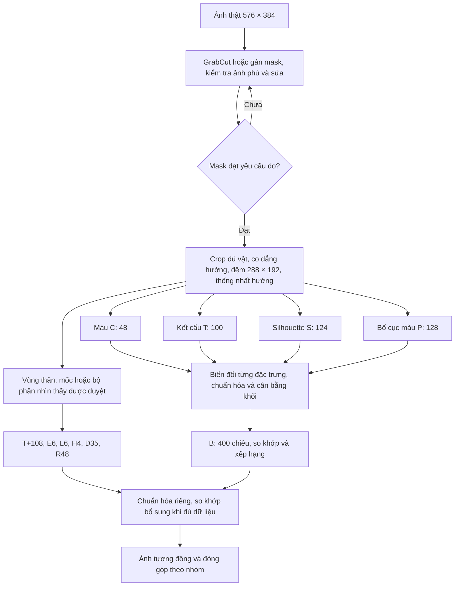

# Yêu cầu 2 — Thiết kế bộ thuộc tính tìm kiếm ảnh động vật bốn chân

## 1. Phạm vi, nguồn và mức độ xác nhận

**Đề xuất chính:** dùng bộ cơ bản **B = 400 chiều**, kết hợp màu tiền cảnh, kết cấu, hình dạng mặt nạ và bố cục màu; thử thêm các khối mô tả họa tiết hoặc bộ phận cho những trường hợp khó. Đây là **báo cáo phân tích và thiết kế**, chưa phải hệ thống tìm kiếm đã triển khai hay đã đánh giá.

Ba loại thông tin được phân biệt xuyên suốt:

- **Đã kiểm tra/quan sát:** kiểm kê ảnh bằng chương trình; xem 84 ảnh mẫu; mở thêm 8 ảnh gốc; chạy riêng bước tạo mặt nạ của mã tham khảo trên 8 ảnh thật.
- **Suy luận từ mã:** số chiều, phép tính, các nguồn nhiễu trong `feature_extractors.py`. Không chạy toàn bộ bộ trích xuất của bài chim.
- **Thiết kế chưa kiểm nghiệm:** các vector 400, 508, 607 chiều, tham số khởi đầu và phương pháp so khớp bên dưới. Chưa có vector của toàn tập, trọng số tối ưu, kết quả PCA hoặc độ chính xác truy hồi.

Nguồn đầu vào:

| Nguồn | Vai trò và phạm vi sử dụng |
|---|---|
| [Bộ ảnh thật](../../data/cropped_images_576x384/) | Đối tượng phân tích của nhóm; chỉ tính ảnh đang ở thư mục này. |
| [Báo cáo giống–khác của nhóm](animal_comparison.md) | Định hướng chọn cặp ảnh, sau đó kiểm tra lại trên ảnh hiện có. Không coi các số liệu trong tài liệu là lần kiểm kê mới. |
| [feature_extractors.py](../../outputs/backups/pre_migration_20261017_100229/external_dependencies/feature_extractors.py) | Mã tham khảo **tìm kiếm ảnh chim**; phân tích trực tiếp các hàm và hằng số. |
| [README tham khảo](../../outputs/backups/pre_migration_20261017_100229/external_dependencies/reference_readme.md) | Mô tả hệ thống chim. Các câu hướng dẫn bảo vệ, chạy hệ thống, dữ liệu 1.239 ảnh chim, PCA 512 chiều và kết quả đánh giá của tài liệu này không phải yêu cầu thực thi hoặc kết quả của nhóm động vật. |

Không tìm thấy tệp riêng tên `Văn bản đã dán (1).txt` trong thư mục làm việc hoặc Downloads; đã đọc trực tiếp tệp `feature_extractors.py` người dùng cung cấp. Báo cáo không giả định đã đọc một bản đính kèm khác chưa truy cập được.

### 1.1. Kiểm kê lại dữ liệu thật

Đọc và giải mã toàn bộ ảnh trong `data/cropped_images_576x384/`: **812/812 ảnh mở được, đều JPEG, đều 576 × 384 pixel, tỉ lệ 3:2**. Không gộp ảnh nguồn hoặc ảnh đã loại. Kết quả tái lập ở [kiem_ke.json](../../outputs/inventory/image_inventory.json), chương trình ở [audit_images.py](../../tools/validation/audit_images.py).

Nhãn được đọc từ tiền tố tên tệp, gộp chữ hoa/thường, gạch nối/gạch dưới, các biến thể tên chó và tên giống mèo. Đây là **nhãn đang gán theo tên tệp**, chưa phải xác nhận phân loại sinh học cho từng ảnh.

| Nhãn đang gán | Số ảnh | Nhãn đang gán | Số ảnh |
|---|---:|---|---:|
| Gấu trúc lớn — Ailuropoda melanoleuca | 16 | Bò nhà — Bos taurus | 42 |
| Trâu, tên tệp Bubalus bubalis | 7 | Lạc đà hai bướu — Camelus bactrianus | 71 |
| Lạc đà một bướu — Camelus dromedarius | 72 | Sói xám — Canis lupus | 9 |
| Chó nhà — Canis familiaris và biến thể | 69 | Dê nhà — Capra hircus | 10 |
| Hươu, nai — **họ Cervidae** | 24 | Lừa nhà — Equus asinus | 10 |
| Ngựa nhà — Equus caballus | 17 | Ngựa vằn — Equus quagga | 279 |
| Mèo nhà và tên giống — Felis catus | 5 | Chuột lang nước — Hydrochoerus hydrochaeris | 26 |
| Lợn đất — Orycteropus afer | 2 | Cừu nhà — Ovis aries | 43 |
| Sư tử — Panthera leo | 8 | Báo hoa mai — Panthera pardus | 2 |
| Hổ — Panthera tigris | 53 | Gấu đen Bắc Mỹ — Ursus americanus | 10 |
| Gấu nâu — Ursus arctos | 14 | Cáo đỏ — Vulpes vulpes | 23 |
| **Tổng** | **812** | **Số nhóm nhãn** | **22** |

Số đếm khớp báo cáo giống–khác, nhưng tệp `thong_ke_loai_dong_vat.csv` được báo cáo đó dẫn hiện **không có** tại đường dẫn đã nêu. Bảng trên được tính lại từ ảnh, không lấy từ CSV đó. Cervidae là nhãn **cấp họ**, không gọi 22 nhóm này là 22 loài.

### 1.2. Mẫu đã xem và vấn đề nhãn

Trong mỗi nhãn, chọn ảnh đầu, giữa và cuối theo thứ tự tên tệp; thêm các ảnh phục vụ cặp so sánh, loại trùng, được **84 ảnh**. Đã xem cả 84 trên sáu bảng ảnh ở kích thước 288 × 192 mỗi ảnh. Các bảng ảnh thu nhỏ đã được lược bỏ khi dọn dự án; danh sách tên ảnh chính xác vẫn được giữ tại [anh_da_xem.csv](../../outputs/inventory/viewed_images.csv). Có thể tạo lại các bảng bằng [audit_images.py](../../tools/validation/audit_images.py) từ bộ dữ liệu hiện tại.

Mở thêm ở 576 × 384: bốn ảnh `Camelus_dromedarius_0892.jpg`, `0894.jpg`, `0910.jpg`, `0912.jpg`; `Bos_taurus_1287.jpg`; `Equus_asinus_0587.jpg`; `Panthera_pardus_0611.jpg`; `panthera-tigris_0250.jpg`. **Không khẳng định đã kiểm tra thị giác toàn bộ 812 ảnh.**

Ghi chú về nhãn và các ảnh mẫu cần lưu ý khi đánh giá:

- Bốn ảnh [0892](../../data/cropped_images_576x384/Camelus_dromedarius_0892.jpg), [0894](../../data/cropped_images_576x384/Camelus_dromedarius_0894.jpg), [0910](../../data/cropped_images_576x384/Camelus_dromedarius_0910.jpg), [0912](../../data/cropped_images_576x384/Camelus_dromedarius_0912.jpg) được giữ nhãn lạc đà một bướu (`Camelus_dromedarius`) theo quyết định gán nhãn của bộ dữ liệu. Quan sát trước đây ghi nhận hai đỉnh rõ trên đường lưng; đặc điểm hình ảnh này không được dùng để đổi nhãn của bốn tệp.
- [Bò 1287](../../data/cropped_images_576x384/Bos_taurus_1287.jpg) có **thân rất sẫm, mặt trắng, các vùng chân/bụng sáng**, không phải một khối tối đồng nhất. [Ngựa 1024](../../data/cropped_images_576x384/Equus_caballus_1024.jpg) có mảng trắng–nâu sẫm. Cần giữ chi tiết này khi dùng ví dụ từ báo cáo cũ.
- [Panthera_leo_1164.jpg](../../data/cropped_images_576x384/Panthera_leo_1164.jpg) có hình đầu, thân và đuôi khác rõ hai ảnh sư tử 1155/1157 trong mẫu; nên đối chiếu nguồn ảnh trước đánh giá. Chưa xác nhận lại danh tính; riêng việc không có bờm không đủ kết luận sai nhãn vì ảnh sư tử cái cũng không có bờm.
- Việc gộp tên giống chó/mèo chỉ chuẩn hóa **nhãn đánh giá**, không tạo một giá trị số về giống trong vector.

## 2. Quan sát ảnh thật → tín hiệu cần mô tả

Mỗi nhận xét dưới đây áp dụng cho **các tệp được dẫn**; chưa phải quy luật thống kê cho cả nhãn. Không có số đo tai, chân, bướu hay khoảng cách vector trong bảng này.

| Ảnh thật đã xem | Quan sát thị giác | Thuộc tính nên dùng và giá trị thông tin | Nhiễu cần kiểm soát |
|---|---|---|---|
| [Ngựa 1014](../../data/cropped_images_576x384/Equus_caballus_1014.jpg), [lừa 0587](../../data/cropped_images_576x384/Equus_asinus_0587.jpg), [ngựa vằn 0779](../../data/cropped_images_576x384/equus-quagga_0779.jpg) | Cùng thân ngang và chân dài; tai lừa lộ dài; ngựa vằn có sọc phủ thân. | Tỉ lệ tai/đầu bổ sung cho dáng chung; Gabor theo hướng và vùng giúp phân biệt sọc với lông ít hoa văn. | Lừa gần hướng ba phần tư, tai sát mép trên; không suy chiều dài thật từ pixel. |
| [Chó 0410](../../data/cropped_images_576x384/Canis_familiaris_0410.jpg), [sói 0922](../../data/cropped_images_576x384/Canis_lupus_0922.jpg), [cáo 0314](../../data/cropped_images_576x384/Vulpes_vulpes_0314.jpg) | Chó dáng sói và sói cùng tông xám/nâu, mõm dài; cáo có đuôi xù, chân sẫm và đầu đuôi sáng. | Tỉ lệ mõm, đuôi; màu theo vùng. Histogram toàn thân khó giữ vị trí chân sẫm/đầu đuôi sáng. | Chó nhiều giống; cáo trong mẫu có thân/góc nhìn khác, không thể gán ngưỡng tách loài. |
| [Hổ 0250](../../data/cropped_images_576x384/panthera-tigris_0250.jpg), [báo 0611](../../data/cropped_images_576x384/Panthera_pardus_0611.jpg) | Nền lông vàng với dấu đen; hổ có vệt dài, báo có đốm/hoa văn cụm. | Năng lượng Gabor theo hướng và tần số; độ kéo dài của thành phần tối. Giữ được khác biệt “vệt dài” và “cụm tròn”. | Cỏ che chân báo; lá/đất có kết cấu; kích thước họa tiết phụ thuộc tỉ lệ chủ thể. |
| [Bò 1287](../../data/cropped_images_576x384/Bos_taurus_1287.jpg), [trâu 0639](../../data/cropped_images_576x384/bubalus-bubalis_0639.jpg) | Thân nặng, màu sẫm ở cả hai; bò mặt trắng, trâu có cặp sừng cong nổi bật. | Màu vùng đầu; độ rộng và độ cong sừng. Màu sẫm toàn cục có thể làm hai ảnh gần nhau. | Tên tệp trâu chưa thay thế xác minh phân loại; đầu quay về máy làm thay đổi hình sừng. |
| [Hai bướu 0303](../../data/cropped_images_576x384/Camelus_bactrianus_0303.jpg), [một bướu 0434](../../data/cropped_images_576x384/Camelus_dromedarius_0434.jpg) | Cùng thân vàng/nâu, chân/cổ dài; đường lưng có hai đỉnh so với một đỉnh. | Biên trên **vùng thân**, số đỉnh có độ nổi đủ lớn và khoảng cách hai đỉnh. Histogram màu khó tách cặp này. | Cổ/đầu không được tính thành bướu; lông xù và góc xiên làm đổi đường lưng. |
| [Gấu đen 0649](../../data/cropped_images_576x384/ursus-americanus_0649.jpg), [gấu nâu 1177](../../data/cropped_images_576x384/Ursus_arctos_1177.jpg), [1206](../../data/cropped_images_576x384/Ursus_arctos_1206.jpg) | 0649 sẫm, 1177 nâu/xù; 1206 cũng khá sẫm và đang cúi đầu. | Màu + kết cấu lông + đường vai/lưng; không chỉ dùng độ tối. | Ánh sáng và tư thế có thể lấn át khác biệt giữa hai nhãn. |
| **Cùng nhãn chó:** [0052](../../data/cropped_images_576x384/Canis_familiaris_0052.jpg), [Doberman 0953](../../data/cropped_images_576x384/Canis_lupus_familiaris_doberman_0953.jpg) | Poodle lông hồng, xù và tạo khối tròn; Doberman lông ngắn đen–nâu, thân thon. | Kết hợp nhiều nhóm; cả màu lẫn đường bao đều có thể xa nhau dù cùng nhãn. | Không có bảo đảm đặc trưng cổ điển sẽ gom mọi giống chó; hồng là đặc điểm ảnh này, không phải dấu hiệu nhãn. |
| **Cùng nhãn bò:** [1254](../../data/cropped_images_576x384/Bos_taurus_1254.jpg), [1287](../../data/cropped_images_576x384/Bos_taurus_1287.jpg), thêm [1277](../../data/cropped_images_576x384/Bos_taurus_1277.jpg) | 1254 có nhiều mảng đen–trắng; 1287 chủ yếu thân sẫm/mặt trắng; 1277 cúi đầu. | Hình thân hỗ trợ khi màu khác nhau; màu theo vùng giữ mặt trắng; dùng đường đầu–cổ thận trọng với 1277. | Cùng nhãn nhưng màu, vùng mảng và đường bao đổi mạnh. |
| **Cùng họ Cervidae:** [0568](../../data/cropped_images_576x384/cervidae_0568.jpg), [0633](../../data/cropped_images_576x384/cervidae_0633.jpg) | Một ảnh xám, gạc phân nhánh lớn; một ảnh nâu có đốm trắng và không thấy gạc. | Kết cấu đốm, cấu trúc gạc khi quan sát được; giữ mô tả chung thân/chân. | Nhãn cấp họ có biến thiên tự nhiên lớn; “không thấy” không đồng nghĩa “không có”. |
| [Cừu 0187](../../data/cropped_images_576x384/ovis-aries_0187.jpg), [dê 1005](../../data/cropped_images_576x384/Capra_hircus_1005.jpg) | Cừu có lông cuộn/xù; dê lông phẳng hơn và cúi đầu ăn. | LBP nhiều bán kính, GLCM và Gabor mô tả bề mặt; hình dạng đầu bị tư thế ảnh hưởng. | Độ nét và cỏ nền cũng tạo kết cấu. |
| [Gấu trúc 1218](../../data/cropped_images_576x384/Ailuropoda_melanoleuca_1218.jpg), [sư tử 1155](../../data/cropped_images_576x384/Panthera_leo_1155.jpg), [1157](../../data/cropped_images_576x384/Panthera_leo_1157.jpg) | Gấu trúc có khối đen ở tai/vai/chân; sư tử 1155 có bờm, 1157 không có bờm. | Bố cục màu giữ vị trí mảng; kết cấu và biên đầu ghi nhận bờm khi thấy. | Lưới ảnh chỉ xấp xỉ vùng cơ thể; bờm không phải thuộc tính luôn có của nhãn sư tử. |

## 3. Phân tích mã tham khảo: bốn nhóm và số chiều

Các số chiều dưới đây được xác định từ phép nối mảng trong mã, không lấy tổng 1.460 làm giả thiết. Dòng mã tham chiếu theo bản `feature_extractors.py` đã đọc.

| Nhóm / thành phần | Định nghĩa, cách tính thực tế trong mã | Số chiều | Khả năng dùng cho động vật bốn chân |
|---|---|---:|---|
| **Màu — HSV histogram** | Mỗi kênh H/S/V có 32 bin, chỉ đếm pixel mask > 0, mỗi histogram chia tổng; H trong [0,180), S/V trong [0,256). | 3 × 32 = **96** | Hữu ích cho lông đen–trắng, vàng/cam; chưa giữ vị trí mảng và chưa mô tả phân bố màu đồng thời. |
| Màu — Lab histogram | 32 bin cho mỗi kênh OpenCV Lab uint8, cùng cách chuẩn hóa. | 3 × 32 = **96** | Bổ sung sắc độ; có thông tin trùng HSV. Kênh Lab uint8 là mã hóa OpenCV, không phải trực tiếp miền Lab vật lý. |
| Màu — moments HSV và Lab | Mean, std, skewness trên pixel tiền cảnh, cho 6 kênh. Không chuẩn hóa thang đo từng giá trị trước nối. | 6 × 3 = **18** | Nén gọn phân bố; mean hue tuyến tính không xử lý tính vòng của màu; mean/std có thể lớn hơn nhiều histogram. |
| **Tổng màu** | `get_color_features`, dòng 154–189. | **210** | Nên rút gọn, chuẩn hóa theo khối và bổ sung vị trí. |
| **Kết cấu — LBP** | LBP uniform P=8, R=1; histogram 10 bin trên các tâm thuộc mask; chia tổng. Lân cận của tâm vẫn có thể đi ra nền. | **10** | Hữu ích cho lông/cuộn/đốm nhỏ, nhưng một bán kính chưa đủ nhiều cỡ họa tiết. |
| Kết cấu — EOH | Sobel x/y trên ảnh xám đầy đủ; histogram 9 hướng [0,180), trọng số độ lớn gradient, lấy các tâm trong mask. | **9** | Gợi hướng sọc; cũng nhận biên vật–nền và cấu trúc khác, không giữ vị trí. |
| Kết cấu — GLCM | Xám lượng tử 64 mức; **đặt nền bằng 0 rồi tính trên cả ảnh**; d=1, bốn góc 0/45/90/135°, đối xứng và chuẩn hóa; energy, contrast, homogeneity, correlation. | 1 × 4 × 4 = **16** | Có ích cho bề mặt, nhưng cách xử lý nền phải sửa. |
| Kết cấu — Gabor | 5 tần số {0,05; 0,10; 0,15; 0,20; 0,25}, 8 hướng iπ/8; lọc xám/255; tính mean/std biên độ phức tại tâm trong mask. | 5 × 8 × 2 = **80** | Hữu ích cho sọc/đốm/lông; cửa sổ lọc vẫn có thể nhận nền; cần ổn định tỉ lệ và giữ vùng. |
| Kết cấu — FFT radial | Đặt nền 0; FFT2 → fftshift → log(1+biên độ); trung bình các vòng tròn, lấy mẫu 64 bán kính và chia giá trị lớn nhất. | **64** | Giữ mức tần số không gian theo bán kính; mất hướng và vị trí, còn nhiễu biên mặt nạ/DC. |
| **Tổng kết cấu** | `get_texture_features`, dòng 309–330. | 10 + 9 + 16 + 80 + 64 = **179** | Nên giữ LBP/Gabor, sửa GLCM; không cần mặc định giữ FFT radial và EOH trùng thông tin. |
| **Hình dạng — Hu + 4 scalar** | 7 Hu biến đổi signed-log; A/(HW); P/[2(H+W)]; P²/(4πAc); 4πAc/P². A đếm mọi pixel mask; P, Ac lấy contour ngoài lớn nhất. | 7 + 4 = **11** | Hữu ích cho khối thân; hai chỉ số cuối nghịch đảo khi khác 0, dư thừa. A và Ac không cùng quy ước nếu mask nhiều mảnh/lỗ. |
| Hình dạng — grid mask | Chia toàn mask 224 × 224 thành lưới 8 × 8; tỉ lệ tiền cảnh trong mỗi ô. | **64** | Giữ vị trí thân/chân, nhưng nhạy dịch chuyển, hướng đầu và kích thước chủ thể trong khung. |
| Hình dạng — width profile | Độ rộng từ pixel đầu đến cuối của mỗi hàng; chia độ rộng lớn nhất; lấy 32 hàng. | **32** | Mô tả bề ngang theo độ cao, không giữ khe giữa các chân trong cùng hàng. |
| Hình dạng — contour profile | Chiều cao từ pixel đầu đến cuối của mỗi cột; chia chiều cao lớn nhất; lấy 32 cột. | **32** | Không phải trực tiếp đường lưng; trộn biên trên và dưới thành một độ cao. |
| Hình dạng — radius signature | Khoảng cách trọng tâm đến các điểm contour lớn nhất, sắp theo góc và nội suy 64 góc; chia max. | **64** | Thô về phần nhô ra; với đường bao lõm/nhiều giao điểm theo một góc, nội suy này không tương đương phép bắn tia lấy biên duy nhất. |
| Hình dạng — HOG | Bbox từ mask; **cắt ảnh xám gốc trong bbox**, ép 64 × 64; 9 hướng, cell 16 × 16, block 2 × 2, L2-Hys. | (4−2+1)² × 2 × 2 × 9 = **324** | Mô tả hướng cạnh của đường bao, họa tiết, bộ phận **và nền còn trong bbox**. Không gọi 324 chiều này là đường bao thuần túy. |
| **Tổng nhóm đặt tên “shape”** | `get_shape_features`, dòng 468–493. | 11 + 64 + 32 + 32 + 64 + 324 = **527** | Tên nhóm không làm HOG trở thành thuộc tính chỉ từ mask. |
| **Không gian — HSV + LBP từng ô** | Toàn ảnh 224 × 224, lưới 4 × 4; mỗi ô 56 × 56, HSV 8 bin/kênh và LBP 10 bin; ô có <10 pixel tiền cảnh trả toàn 0. LBP tính riêng trong từng ô. | 16 × (3 × 8 + 10) = **544** | Giữ bố cục gần đúng; ô không tự tương ứng đầu/chân. Nhạy hướng đầu, dịch chuyển, biên ô và lỗi mask. |

Đối chiếu tổng:

\[
\underbrace{96+96+18}_{210}
+\underbrace{10+9+16+80+64}_{179}
+\underbrace{11+64+32+32+64+324}_{527}
+\underbrace{16(24+10)}_{544}
=\boxed{1460}.
\]

`extract_raw_features` (dòng 551–593) thực hiện: đọc ảnh → ép 224 × 224 → tạo mask → nối bốn nhóm → thay NaN/Inf bằng 0 → **L2 toàn vector một lần**. Hàm trả 1.460 chiều đã L2, dù tên có chữ `raw`. **PCA không nằm trong tệp này**; PCA 512 chiều là bước được README mô tả, chưa được kiểm chứng bằng các tệp chương trình offline/online khác và không phải kết quả của nhóm.

### 3.1. Ép 576 × 384 thành 224 × 224 làm sai gì?

Hệ số co ngang sₓ=224/576=7/18; hệ số co dọc sᵧ=224/384=7/12. Vì sᵧ/sₓ=1,5, con vật bị **hẹp ngang tương đối**: tỉ số rộng/cao mới bằng **2/3** tỉ số ban đầu. Đây là phép tính từ kích thước ảnh, không phải số đo cơ thể.

Thân trông ngắn/cao hơn tương đối, chân và tai theo phương đứng trông dài hơn so với chiều dài thân; hai bướu sát nhau theo chiều ngang và sườn bướu dốc hơn; góc cạnh/sọc và tần số họa tiết đổi theo hướng. Số bướu không nhất thiết đổi do biến đổi hình học liên tục, nhưng thu nhỏ/nội suy có thể làm đỉnh thấp khó tách. Hu không bất biến với co giãn khác nhau theo hai trục. HOG trong mã còn ép bbox thành vuông thêm một lần, tiếp tục thay đổi tỉ lệ ROI.

**Thiết kế thay thế:** giữ ảnh 576 × 384 để phân đoạn/kiểm tra chi tiết; chuẩn hóa crop bằng **một hệ số co chung**, thêm đệm vào canvas 288 × 192. Pixel đệm luôn có mask 0 và không được đếm vào màu/kết cấu. Các tỉ lệ cơ thể tính trước đệm từ tọa độ gốc hoặc tọa độ co đẳng hướng. Không cắt mất tai, sừng, chân hoặc bướu để vừa khung.

### 3.2. GrabCut trên ảnh thật: đã thử, chưa có chuẩn phân đoạn

Trong mã, rectangle cách mép 10 pixel, GrabCut 5 vòng; opening rồi closing kernel ellipse 5 × 5, mỗi phép 2 lần. **Otsu chỉ chạy khi có exception**. Nếu mask sau hình thái học rỗng, mã gán **mọi pixel bằng 255**, chứ không thử Otsu lần nữa. Rectangle ở đây không được lấy từ YOLO trong hàm, dù README nhắc YOLO ở quy trình tiền xử lý khác.

Chạy đúng hàm `create_foreground_mask` và phép resize của mã trên 8 ảnh thật, cố định seed OpenCV=0 cho từng ảnh. Chỉ tách hàm bằng AST; không chạy toàn hệ thống chim. Môi trường: OpenCV 4.12.0, NumPy 1.26.4. Có [mã kiểm tra](../../tools/segmentation/run_grabcut.py), [thông tin phiên bản và SHA-256 nguồn](../../outputs/inventory/grabcut_sample_environment.json), [số đếm pixel](../../outputs/inventory/grabcut_sample_statistics.csv). Chưa có mask chuẩn nên **không tính IoU, tỉ lệ phân đoạn đúng hay độ chính xác**.

| Tệp thử | Pixel mask > 0 / 50.176 | Nhận xét trực tiếp từ mask/ảnh phủ |
|---|---:|---|
| `Equus_asinus_0587.jpg` | 8.816 (17,57%) | Mất tai và phần lớn chân; khối thân còn lại không mô tả đúng con lừa. |
| `equus-quagga_0779.jpg` | 13.868 (27,64%) | Giữ sọc thân nhưng chân thành các khối bị rút gọn/dính; đuôi không được giữ đầy đủ. |
| `cervidae_0568.jpg` | 13.752 (27,41%) | Giữ vùng nền lớn sau lưng và một phần nền/xe phía trước; mất chân/gạc rõ. |
| `Bos_taurus_1254.jpg` | 13.724 (27,35%) | Khối thân được giữ, các chân và phần dưới bị mất/dính; không đạt để đo dáng chân. |
| `Canis_familiaris_0052.jpg` | 15.801 (31,49%) | Khối chó hồng được giữ tương đối, nhưng biên lông và các phần mảnh bị làm thô. |
| `Canis_lupus_familiaris_doberman_0953.jpg` | 13.333 (26,57%) | Nền sáng dưới bụng/giữa chân bị nhập vào tiền cảnh; tai mảnh không được giữ đúng. |
| `Camelus_bactrianus_0303.jpg` | 19.173 (38,21%) | Còn hai đỉnh lưng nhưng nền giữa các chân/dưới thân bị nhập vào mask. |
| `ursus-americanus_0649.jpg` | 22.044 (43,93%) | Giữ khối gấu tương đối rõ; biên chân/lông và nền sát chân vẫn cần sửa. |

Các phần trăm trên là **diện tích đầu ra thuật toán trên ảnh đã ép vuông**, không phải diện tích con vật thật hoặc điểm chất lượng mask. Không dùng chúng làm đặc trưng đã đo của con vật.

**Kết luận trong phạm vi mẫu:** GrabCut tự động với cấu hình này chưa đáng tin để đo tai/chân/gạc. Không suy rộng thành tỉ lệ lỗi trên toàn bộ 812 ảnh. Vật và nền cùng màu, vật sát mép, hàng rào/cỏ che chân và hình thái học mạnh đều là nguồn rủi ro. Hướng dẫn chính thức cũng cho phép đánh dấu bổ sung tiền cảnh/nền để sửa phân đoạn. [Tài liệu GrabCut của OpenCV](https://docs.opencv.org/4.10.0/d8/d83/tutorial_py_grabcut.html).

| Nhóm thuộc tính | Mask bỏ mất vật | Mask giữ nhầm nền |
|---|---|---|
| Màu | Bỏ chân sẫm, mặt trắng hoặc tai; phân bố màu lệch về phần thân còn lại. | Màu cỏ/đất/tuyết đi vào histogram, khiến ảnh cùng nền gần nhau. |
| Hình dạng | Tai ngắn giả, mất chân/gạc, thay đổi Hu và biên lưng. | Lấp khe chân, tăng extent/solidity, biến nền thành khối thân. |
| Kết cấu | Mất sọc/đốm ở phần bị loại. | Học vân cỏ, hàng rào, lá thay cho lông. |
| Không gian | Ô đầu/chân rỗng giả; vị trí mảng bị thiếu. | Các ô nền có màu/kết cấu giả của chủ thể. |

Ở bước triển khai cần lưu mask, ảnh phủ và trạng thái duyệt; cho phép sửa bằng nét foreground/background hoặc polygon. Không tự coi mask toàn trắng, Otsu hay contour lớn nhất là phân đoạn thành công. Chỉ loại mảnh rời sau khi kiểm tra, vì tai, đuôi hoặc chân bị che có thể tạo thành phần rời hợp lệ. Kernel hình thái học phải theo độ phân giải/bề dày bộ phận, tránh mặc định làm mất cấu trúc mảnh.

### 3.3. GLCM, HOG, FFT và chuẩn hóa: những điểm cần sửa

**GLCM:** gán nền=0 không có nghĩa bỏ nền. Các cặp nền–nền tăng P(0,0), thường làm ảnh có vẻ đồng nhất/năng lượng cao; cặp vật–nền có thể tăng tương phản và tạo hiệu ứng hướng theo đường bao. Mức 0 còn là mức xám thật của vùng lông rất tối, nên không thể đơn giản xóa cả hàng/cột 0. Cách sửa là chỉ đếm cặp `(p,p+δ)` khi **cả hai pixel thuộc mask hợp lệ**, rồi đối xứng và chuẩn hóa từng ma trận. `graycomatrix` không nhận mask trong giao diện được dùng; cần đếm cặp bằng NumPy hoặc chọn patch nằm hoàn toàn trong vật. GLCM ghi nhận đồng xuất hiện mức xám theo độ lệch, không trực tiếp nhận biết sọc/loài. [Ví dụ GLCM chính thức](https://scikit-image.org/docs/stable/auto_examples/features_detection/plot_glcm.html).

**HOG:** mã dùng mask để tìm bbox, sau đó tính gradient của ảnh xám trong bbox. Cỏ giữa chân, nền quanh cổ, sọc và đường bao đều có thể tham gia. HOG là mô tả **gradient cục bộ có chuẩn hóa theo block**, không phải riêng silhouette. Bộ cơ bản dưới đây dùng hình dạng từ mask và Gabor cho kết cấu để dễ giải thích. Nếu thử HOG sau này, phải báo rõ loại ảnh đầu vào; HOG của mask vẫn mô tả gradient của silhouette và vẫn nhạy tư thế, còn HOG ảnh xám cần xử lý nền/lân cận hợp lệ. [Mô tả HOG của scikit-image](https://scikit-image.org/docs/stable/auto_examples/features_detection/plot_hog.html).

**FFT radial:** biên độ FFT đã bỏ pha; lấy trung bình theo bán kính còn bỏ chỉ số góc. Vì vậy có thể phản ánh cỡ lặp của họa tiết nhưng **không giữ được hướng sọc hoặc vị trí sọc trên cơ thể**. Sọc ngang/dọc cùng tần số có thể cho profile gần nhau; dịch chuyển lý tưởng không làm đổi biên độ phổ. Trong mã, nền=0 tạo bước nhảy theo mask, không trừ trung bình hay đặt cửa sổ giảm biên; thành phần DC và biên vật cũng ảnh hưởng phổ. Thay bằng Gabor giữ hướng kết hợp phân vùng; nếu thử FFT thì cần patch bên trong thân, bỏ DC, cửa sổ Hann và phổ theo góc, không chỉ radial.

**L2 một lần:** với `x=[C,T,S,P]`, chuẩn hóa `x/||x||₂` chỉ chia mọi tọa độ cho cùng một số. Tỉ lệ đóng góp `||C||₂²/||T||₂²` không đổi. Mean màu thang 0–255, contrast GLCM tới 63², Hu signed-log và histogram 0–1 có thể chênh lớn. Nhóm nhiều chiều có thể chi phối nếu các tọa độ có cỡ tương tự; số chiều lớn không tự động đồng nghĩa chi phối. L2 cuối không thay thế chuẩn hóa từng biến/khối. Đề xuất cụ thể ở mục 6.

## 4. Bộ thuộc tính cơ bản B — 400 chiều

### 4.1. Quy ước tiền xử lý và chuẩn hóa

B áp dụng chung cho **mọi nhóm nhãn**, không dùng tên tệp để chọn công thức trích xuất. Điều kiện là mặt nạ đã qua kiểm tra; kết quả GrabCut lỗi không được tự động coi là dữ liệu đúng.

1. Phân đoạn trên ảnh gốc 576 × 384, lưu mask 0/1 và ảnh phủ để duyệt; sửa vùng chân, tai, sừng và nền khi cần. Bbox bao toàn bộ phần vật nhìn thấy, kể cả đuôi/sừng. Không suy ra phần bị che.
2. Cắt theo bbox, co đẳng hướng lớn nhất vừa canvas **288 × 192**, đặt giữa và thêm đệm. Ảnh màu nội suy phù hợp thu nhỏ; mask nội suy nearest-neighbor. Đây là kích thước thiết kế ban đầu, chưa chứng minh tối ưu. Tỉ số bbox và kích thước bộ phận đo trước đệm.
3. Với ảnh nhìn ngang có hướng đầu rõ, thống nhất đầu sang trái bằng đánh dấu hướng khi duyệt hoặc một bộ ước lượng hướng sẽ kiểm nghiệm sau. Không dùng nhãn để quyết định hướng. Nếu không rõ, có thể tính cả ảnh và ảnh lật, lấy khoảng cách nhỏ hơn với **cùng quy tắc cho mọi ảnh**; ghi rằng đây là so khớp hai hướng. Không tự xoay để ép tư thế cổ/chân.
4. Màu tính trên pixel tiền cảnh. LBP chỉ lấy tâm có đủ lân cận trong mask. Gabor chỉ lấy tâm có cửa sổ lọc nằm trong phần vật hợp lệ; vùng quá hẹp không ép thành quan sát tốt. GLCM chỉ dùng cặp có hai đầu hợp lệ. Vùng đệm không tham gia kết cấu.

Ký hiệu dùng trong bảng:

- **H:** histogram không âm, chia tổng L1 rồi lấy căn từng phần tử: `h'=sqrt(h/sum(h))`. Cách này giữ ý nghĩa phân bố; L2 giữa hai histogram biến đổi liên hệ khoảng cách Hellinger. Các histogram con được cân bằng trước nối, không chuẩn hóa z từng bin một cách mặc định.
- **Z:** chuẩn hóa từng biến liên tục bằng `z_j=(t_j−μ_j)/(σ_j+ε)`; μ/σ chỉ fit trên tập phát triển/tham chiếu hợp lệ, lưu lại để áp dụng cho truy vấn. Chiều không biến thiên được đặt 0 và ghi nhận. Với tỉ lệ dương rất lệch dùng `log1p` trước Z. Z có miền thực, không giới hạn [0,1].
- **U:** chuẩn hóa L2 của một khối sau biến đổi. Các khối con trong cùng nhóm được cân bằng như mục 6. “0/1” là mã mask, không phải nhãn loài.

Đây là các quy tắc thiết kế; chưa fit μ/σ hay tạo vector B từ toàn bộ dữ liệu. StandardScaler chuẩn hóa theo từng biến và chịu ảnh hưởng ngoại lệ; nếu dữ liệu phát triển cho thấy ngoại lệ mạnh, thử median/IQR thay thế rồi đánh giá, không đổi thang đo riêng cho từng ảnh. [Tài liệu StandardScaler](https://scikit-learn.org/stable/modules/generated/sklearn.preprocessing.StandardScaler.html).

### 4.2. Bảng chi tiết từng thuộc tính cơ bản

Trong bảng, A là diện tích silhouette; w,h là rộng/cao bbox; P là chu vi; A_hull là diện tích convex hull. Các đại lượng trong cùng công thức phải dùng cùng quy ước tọa độ/diện tích.

| ID / thuộc tính | Định nghĩa và cách tính | Số chiều; miền gốc → chuẩn hóa | Mask? Vùng đo | Giá trị thông tin / cặp áp dụng | Giới hạn tư thế, góc nhìn, ánh sáng, che khuất |
|---|---|---|---|---|---|
| **C1 — màu HSV** | Histogram H 16 bin, S 8 bin, V 8 bin. H dùng trọng số S/255 để vùng xám không tạo màu hue giả; phân bố hue xử lý vòng tại 0/180. S,V đếm bình thường. | **32**; bin không âm, sau L1 trong [0,1]; **H**, cân bằng ba kênh rồi U. Nếu tổng trọng số H bằng 0 thì kênh hue không có thông tin. | Có; toàn bộ phần vật nhìn thấy. | Đen–trắng của ngựa vằn/gấu trúc, vàng/cam của hổ, tông lông gấu. S,V giúp phân biệt trắng/đen khi hue ít nghĩa. | Đổi sáng làm V đổi; bóng và cân bằng trắng làm phân bố lệch. Chó hồng và bò nhiều màu khiến cùng nhãn vẫn xa. |
| **C2 — sắc độ Lab** | Histogram a và b, mỗi kênh 8 bin trên mã Lab uint8 [0,256). Không thêm L để giảm lặp với V. | **16**; bin [0,1] sau L1; **H**, cân bằng hai kênh rồi U. | Có; toàn vật. | Bổ sung khác biệt tông vàng/nâu so với xám; hữu ích cùng C1 cho hổ–ngựa vằn, gấu và bò. | Không tự bất biến ánh sáng/cân bằng trắng; histogram biên từng kênh không giữ tương quan màu hoặc vị trí. |
| **T1 — LBP hai bán kính** | Xám uint8; uniform P=8, R=1 và R=3 trên canvas chuẩn hóa; mỗi bán kính 10 bin. Chỉ chọn tâm có đủ lân cận hợp lệ trong mask. | **20 = 2×10**; histogram [0,1]; **H** từng bán kính, cân bằng rồi U. | Có; phần trong vật, tránh biên/nền. | Lông mịn so với xù/cuộn; cừu 0187–dê 1005; bổ sung cho gấu, chó. | Nhiễu, nhòe, tỉ lệ họa tiết và độ phân giải ảnh gốc; LBP uniform gom nhiều mẫu khác nhau, không xác nhận đốm hay sọc riêng biệt. |
| **T2 — GLCM có mask cặp pixel** | Lượng tử 64 mức; d={1,3}, θ={0°,45°,90°,135°}; chỉ đếm cặp trong vật, đối xứng, mỗi P(i,j) tổng 1. Tính energy=√ΣP²; contrast=Σ(i−j)²P; homogeneity=ΣP/[1+(i−j)²]; correlation từ hiệp phương sai hai mức xám. | **32 = 2×4×4**; energy/homogeneity [0,1], contrast [0,3969], correlation [−1,1]. Chia contrast cho 3969, sau đó **Z**, U. Patch hằng số không có phương sai: correlation đánh dấu không xác định, không biến thành bằng chứng tương đồng. | Có; cặp trong phần vật nhìn thấy, không tính nền hoặc cặp bắc qua nền. | Độ thô và biến thiên mức xám ở hai cỡ; giúp cừu–dê, lông gấu, vùng sọc/đốm. | Không mô tả ý nghĩa vật thể; hướng chụp, độ nét, bóng và lượng tử xám ảnh hưởng. Ít cặp hợp lệ thì kết quả kém ổn định. |
| **T3 — Gabor giữ hướng** | Xám/255; f={0,08;0,16;0,24} chu kỳ/pixel, θ={0°,45°,90°,135°}; đáp ứng r=√(real²+imag²), lấy mean/std tại các tâm hợp lệ. Giữ riêng từng hướng và tần số, không trung bình góc. Thiết kế hỗ trợ kernel `n_stds=2`. | **48 = 3×4×2**; mean/std ≥0, không giả định cận trên 1; `log1p` → **Z**, U. | Có; phần trong vật có cửa sổ lọc hợp lệ, bỏ vùng sát biên theo hỗ trợ từng kernel. | Phân biệt họa tiết thiên hướng dài với ít định hướng, cỡ sọc/đốm và lông; hổ–báo, ngựa vằn–ngựa/lừa. | Tổng hợp toàn vật còn mất vị trí; hướng đổi theo tư thế; sọc và lông có thể cùng tạo đáp ứng. Tần số là theo ảnh chuẩn hóa, không phải kích thước thật. |
| **S1 — Hu của silhouette** | Tính 7 Hu trên mask 0/1 hoặc `moments(...,binaryImage=True)`; h=0 trả 0, khác 0 dùng `−sign(h)log10(max(abs(h),10⁻¹²))`. | **7**; giá trị signed-log hữu hạn, coi là miền thực → **Z**, U. | Có; toàn silhouette được duyệt. | Khối thân tổng thể; hỗ trợ ngựa–bò, thân gấu–họ mèo, chuột lang nước. | Chỉ xấp xỉ bất biến dịch/chỉnh tỉ lệ đẳng hướng/quay trong mặt phẳng; không bất biến tư thế, phối cảnh, che khuất hoặc mask sai. Hu không định vị tai/bướu. |
| **S2a — tỉ số bbox** | w/h trên bbox chưa thêm đệm. | **1**; >0; `log(w/h)` → **Z**. | Có; toàn vật nhìn thấy. | Dáng dài/thấp so với gọn/cao. | Đầu cúi, đuôi giơ, sừng và góc chụp thay bbox; không suy chiều cao thật. |
| **S2b — extent** | A/(w×h). | **1**; [0,1] → **Z**. | Có; bbox và silhouette. | Mức lấp đầy khung: thân đặc so với nhiều khoảng hở quanh cổ/chân. | Mask lấp khe chân làm tăng giả; phụ thuộc tư thế và hướng nhìn. |
| **S2c — solidity** | A/A_hull; tính hull của toàn silhouette hợp lệ theo cùng quy ước diện tích. | **1**; (0,1] → **Z**. | Có; toàn silhouette. | Độ lõm quanh chân, cổ, đuôi; bổ sung cho thân gọn so với nhiều phần nhô. | Không phân biệt nguyên nhân lõm; che chân, dính nền hoặc sừng dài làm đổi chỉ số. |
| **S2d — circularity** | 4πA/P² với diện tích/chu vi từ cùng biên hình học; giữ một chỉ số này, bỏ compactness nghịch đảo. | **1**; lý tưởng (0,1]; sai số rời rạc cần kiểm tra, không mặc định mọi ước lượng pixel đều ≤1 → **Z**. | Có; tổng biên silhouette, kể cả biên các phần rời đã xác nhận thuộc vật. | Thân tròn/gọn so với biên dài và nhiều chi; gấu/capybara so với lừa/ngựa. | Nhạy răng cưa, độ phân giải, lông và sừng; chuẩn hóa crop không khử đổi tư thế. |
| **S2e — eccentricity** | Từ trị riêng λ₁≥λ₂ của hiệp phương sai tọa độ pixel mask: √(1−λ₂/λ₁); λ₁=0 là không hợp lệ. | **1**; [0,1] → **Z**. Năm scalar S2 ghép chung **5 chiều**, U sau Z. | Có; phân bố khối toàn vật. | Khối kéo dài so với gần tròn; thêm tín hiệu khi màu giống. | Chỉ mô tả ellipse tương đương, không đo riêng chân/tai và không phân biệt bướu. |
| **S3 — mật độ mask 6×8** | Canvas 192 hàng × 288 cột; chia **6 hàng × 8 cột**, ô 32 × 36; mỗi ô = số pixel mask / diện tích ô. | **48**; [0,1] → U. Giữ giá trị 0 của ô thật sự không có vật. | Có; lưới toàn crop đã đệm, thống nhất hướng. | Giữ vị trí thô đầu, thân, khoảng chân và đuôi. Hữu ích cho toàn tập. | Lưới không phải bộ phận giải phẫu; nhạy bbox, đầu cúi, hướng/độ che khuất; không đủ đo tai nhỏ. |
| **S4 — biên trên và dưới** | Chia chiều ngang canvas thành 32 dải; tại mỗi dải có vật lấy y nhỏ nhất/lớn nhất và chia H=192; nối 32 giá trị trên + 32 dưới. Dải trống quy ước cả hai bằng 0, được nhận biết cùng mask/occupancy, không đọc là biên cơ thể ở y=0. | **64 = 32+32**; [0,1] → U, cân bằng với S1/S2/S3. | Có; silhouette toàn crop. | Giữ riêng đường lưng và đường chân/bụng thay vì chỉ độ cao; hỗ trợ lạc đà, ngựa/lừa, thân gấu. | Dải có cổ/đầu/đuôi có thể tạo đỉnh giả; chân nhấc/cúi đầu làm đổi biên; chưa phải bộ đếm bướu của thân. |
| **P — bố cục màu 2×4** | Chia canvas **2 hàng × 4 cột**; mỗi ô HSV H8/S4/V4 chỉ trên tiền cảnh, H có trọng số saturation như C1. Nối theo hàng rồi cột. | **128 = 8×16**; bin [0,1], **H** từng kênh, cân bằng kênh/ô và U toàn P. Ô không có vật có vector 0; thiếu dữ liệu do mask lỗi phải đánh dấu riêng. | Có; từng ô không gian trên vật. | Giữ mảng đen vai/chân của gấu trúc, mặt sáng và thân tối của bò, lưng/bụng khác màu. Khác với C, đổi vị trí mảng có thể làm P đổi. | Ô ảnh chỉ xấp xỉ vùng đầu/lưng/bụng; quay đầu hoặc góc trước làm lệch vùng; ô ít pixel dễ nhiễu. Không định vị chính xác mắt hoặc đầu đuôi. |

Các tham số bin, tần số, bán kính và lưới là **lựa chọn kỹ thuật ban đầu**, không phải kết quả tối ưu từ bộ dữ liệu. Gabor là bộ lọc có hướng/tần số; ý nghĩa hướng và phản hồi thực/ảo theo API chính thức, còn việc dùng chúng cho các cặp nhãn ở đây là đề xuất của báo cáo. [Tài liệu bộ lọc Gabor](https://scikit-image.org/docs/stable/api/skimage.filters.html#skimage.filters.gabor).

### 4.3. Cấu trúc và phép cộng của B

\[
\begin{aligned}
C&=[C1_{32};C2_{16}]&&\Rightarrow48,\\
T&=[T1_{20};T2_{32};T3_{48}]&&\Rightarrow100,\\
S&=[S1_7;S2_5;S3_{48};S4_{64}]&&\Rightarrow124,\\
P&=[HSV_{16}^{(r,c)}]_{r=1..2,c=1..4}&&\Rightarrow128,\\
B&=[C;T;S;P]&&\Rightarrow\boxed{48+100+124+128=400}.
\end{aligned}
\]

Thứ tự chỉ số, tính từ 0:

| Khối | Chỉ số | Số chiều |
|---|---|---:|
| C1; C2 | 0–31; 32–47 | 32+16 |
| T1; T2; T3 | 48–67; 68–99; 100–147 | 20+32+48 |
| S1; S2; S3; S4 | 148–154; 155–159; 160–207; 208–271 | 7+5+48+64 |
| P | 272–399 | 128 |

## 5. Bộ thuộc tính bổ sung cho các trường hợp dễ nhầm

Các khối bổ sung khai thác **vùng thân và bộ phận nhìn thấy**, không dùng tên loài làm dữ liệu. Đề xuất giai đoạn đầu đánh dấu polygon vùng thân/đầu, mốc tai–mõm–chân–đuôi trên ảnh thật khi cần. Chưa có bộ phát hiện landmark đã được huấn luyện/kiểm chứng; không giả định OpenCV tự biết đâu là tai, sừng hoặc bướu.

Quy ước: L_thân là chiều dài trục thân từ vai đến gốc đuôi nhìn thấy; D_thân là độ sâu thân trung vị, vuông góc trục thân; L_đầu từ mốc sau sọ đến đầu mõm, W_đầu là bề rộng đầu trong ảnh. Đo trên tọa độ gốc/đẳng hướng. Đây là **tỉ lệ chiếu trong ảnh**, không phải số đo giải phẫu thật. Mốc không xác định do che/góc nhìn thì ghi thiếu, không đoán và không gán số 0 như một phép đo thật.

| Khối / thuộc tính | Định nghĩa và cách tính | Số chiều; miền và chuẩn hóa | Mask / vùng đo | Giá trị thông tin, cặp áp dụng | Giới hạn và tình trạng triển khai |
|---|---|---|---|---|---|
| **T+1 — Gabor theo vùng thân** | Polygon thân bỏ đầu, cổ, đuôi/chân và nền; chia hai nửa trước/sau theo trục thân đã đánh dấu. Dùng cùng 3 tần số, 4 hướng, mean/std như T3, giữ riêng từng nửa. | **96 = 2×3×4×2**; ≥0; `log1p` → Z; U từng nửa rồi cân bằng. | Có mask + polygon thân; chuẩn hóa đẳng hướng theo L_thân về cùng độ dài tham chiếu 192 pixel để giảm sai khác cỡ họa tiết do bbox có cổ/đuôi dài. | Sọc thân hổ/ngựa vằn có hướng và cỡ khác nhau; phân bố hướng trước/sau giúp giữ thay đổi sọc quanh vai và hông; bổ sung cho ngựa–lừa–ngựa vằn, hổ–báo. | Không giữ chính xác từng sọc; thân xoay/da cong làm đổi hướng; thiếu vùng thân hoặc kernel không đủ hỗ trợ thì bỏ phép đo. Polygon hiện là phương án gán tay/bán tự động chưa kiểm nghiệm. |
| **T+2 — thành phần tối nhiều cỡ** | Trong từng nửa thân hợp lệ, với σ={1,2,4} pixel trên ảnh thân chuẩn hóa, lấy D=max(0,Gaussianσ(I)−I). Chọn ngưỡng Otsu từ D trong vùng hợp lệ, tìm thành phần tối 8-liên thông; loại thành phần cắt biên patch. Lấy (a) trung vị λ_min/λ_max của hiệp phương sai tọa độ từng thành phần; (b) số thành phần/diện tích pixel hợp lệ. | **12 = 2 vùng×3 cỡ×2**; độ tròn-kéo dài [0,1], mật độ [0,1] theo đơn vị pixel; Z rồi U. Không có thành phần: mật độ=0; hình dạng thành phần là thiếu, không giả làm tròn. | Có; phần trong hai nửa thân; tránh biên và che khuất. | Vệt dài có tỉ lệ trị riêng nhỏ hơn cụm tròn; bổ sung phân biệt sọc hổ và đốm/hoa văn báo. Kết hợp màu phân biệt ngựa vằn và hổ. | Sọc phân nhánh, đốm dính nhau, lông đen và bóng đều gây sai; không khẳng định Otsu luôn tách được họa tiết. Tất cả ngưỡng/phép đo cần kiểm nghiệm. |
| **E — tai và đầu/mõm** | Sáu phép đo: L_tai/L_đầu; W_tai/L_tai; góc trục tai với trục đầu chia π; L_mõm/L_đầu; W_mõm/W_đầu; L_đầu/L_thân. Nếu thấy hai tai, dùng tai gần máy, nhìn rõ nhất theo quy tắc nhất quán. | **6**; tỉ lệ ≥0, góc [0,1]; tỉ lệ dương `log1p` rồi Z, góc Z; U toàn E. | Mask/đường biên bộ phận + mốc gán; vùng đầu/tai. | Tai lừa 0587 so với ngựa 1014; mõm và tỉ lệ đầu cho chó–sói–cáo. Thể hiện hình học bộ phận mà Hu toàn thân dễ làm mờ. | Tai gập/cụp, mặt quay trước và lông che tai làm phép đo không tương đương; chó nhiều giống không có một giá trị đặc trưng chung. Chưa đo sáu số này từ các ảnh ví dụ. |
| **L — cổ, chân, đuôi** | Sáu tỉ lệ: L_cổ/L_thân; chiều dài đường gấp khúc chân trước gần máy nhìn thấy/D_thân; L_thân/D_thân; chiều dài đường giữa đuôi/L_thân; bề rộng đuôi lớn nhất/D_thân; góc gốc→đầu đuôi với trục thân chia π. | **6**; tỉ lệ ≥0, góc có dấu [−1,1]; `log1p` cho tỉ lệ, Z rồi U. | Mask + mốc/trục; cổ, thân, chân gần máy, đuôi. | Đuôi dài/xù của cáo so với chó/sói trong các ảnh đã xem; chân/thân bổ sung cho các động vật móng guốc. | Đuôi cuộn, bị cắt/che, chó cắt đuôi, chân bước hoặc góc xiên làm đổi phép đo; chiều dài nhìn thấy không bằng chiều dài giải phẫu. |
| **H — sừng/gạc** | Bốn phép đo khi quan sát được: độ rộng phủ hai sừng/W_đầu; tỉ số độ dài cung đường giữa sừng/dây cung; số đầu mút nhánh gạc/sừng nhìn thấy; độ cao đầu sừng so với gốc chia L_đầu. Dùng nhánh/sừng nhìn rõ theo quy tắc cố định. | **4**; độ rộng ≥0; cung/dây ≥1; số nhánh là số nguyên ≥0; độ cao tương đối có dấu. `log1p` các lượng không âm, Z, U. | Có đường biên/skeleton bộ phận đã duyệt, mốc đầu; không lấy mọi nhánh skeleton của mask toàn thân. | Sừng cong rộng của ảnh trâu 0639 so với bò 1287; gạc phân nhánh ở Cervidae 0568 khác sừng không phân nhánh. | Mặt quay, một sừng bị che, lông/rào lẫn vào skeleton; không thấy sừng không đồng nghĩa không có. Chỉ “không có nhìn thấy” được ghi quan sát riêng; các tỉ lệ không đo được là thiếu. |
| **D1 — profile lưng thân** | Lấy biên trên **riêng polygon thân**, loại đầu/cổ/đuôi. Đặt trục theo vai→gốc đuôi; lấy 32 vị trí đều theo trục thân. Tại mỗi vị trí tính độ cao biên trên so với đường nối hai đầu lưng, chia D_thân. Giữ cả 32 giá trị, không chỉ đếm đỉnh. | **32**; miền thực theo tỉ lệ chiếu; Z rồi U theo khối D. | Có mask thân + mốc vai/gốc đuôi; lưng/vài. | Hình một/hai bướu; độ nổi và vị trí vùng vai của gấu là tín hiệu phụ. | Áo/yên phủ lưng, bướu nghiêng, lông dày, tư thế cúi và góc trước làm đổi profile; không gọi mọi đỉnh là bướu. |
| **D2 — thống kê đỉnh lưng** | Làm trơn 32 mẫu D1 bằng Gaussian σ=1 mẫu; tìm đỉnh có prominence ≥0,05D_thân và cách nhau ≥4 mẫu, dùng quy ước điểm biên nhất quán. Lưu số đỉnh, prominence lớn nhất/D_thân, khoảng cách hai đỉnh nổi nhất/L_thân. D1 đã chia D_thân nên ngưỡng tương ứng 0,05 trên profile. | **3**; số đỉnh nguyên ≥0, prominence ≥0, khoảng cách [0,1]; Z. <2 đỉnh thì khoảng cách=0 nghĩa không có cặp đỉnh đạt điều kiện; không đồng nghĩa bị che. D=D1+D2 có **35 chiều**. | Như D1, chỉ tính nếu toàn đoạn lưng cần đo nhìn thấy. | Hai đỉnh tách biệt so với một đỉnh ở lạc đà 0303–0434. Với gấu chỉ hỗ trợ hình vai/lưng, không dùng số đỉnh để suy loài. | Các ngưỡng là **đề xuất ban đầu**, chưa tối ưu; không đủ tách bướu thật với đỉnh do lông/mask. Lưng bị che thì D không hợp lệ. |
| **R — màu theo vùng cơ thể** | Đánh dấu ba vùng nhìn thấy: đầu, nửa lưng thân, nửa bụng thân theo trục cơ thể; mỗi vùng HSV H8/S4/V4 giống quy tắc P. | **48 = 3×16**; [0,1] sau L1, H từng kênh; U từng vùng rồi cân bằng. | Có mask + vùng cơ thể có tên; không chỉ lấy một ô ảnh và gọi là đầu. | Mặt trắng bò 1287, bụng sáng hổ, lưng–bụng/mõm ở chó–sói–cáo; màu đầu/thân gấu. Khắc phục phần nào sự lệch ô lưới khi cổ đổi dáng. | Ánh sáng vẫn gây nhiễu; vùng khuất không suy từ nhãn. R không đo riêng màu đầu đuôi; P chỉ giữ đầu đuôi ở mức vị trí thô. |

**T+ = T+1 + T+2 = 96 + 12 = 108 chiều.** E+L+H = 6+6+4 = 16 chiều. D=32+3=35 chiều. R=48 chiều. Một khối có thông tin trùng một phần với B vẫn có thể hữu ích vì đo đúng vùng hoặc đúng bộ phận; cần kiểm tra bằng thí nghiệm bỏ/thêm khối, không mặc định tăng số chiều là tăng chất lượng.

### 5.1. Những bộ vector có thể triển khai

| Bộ / chế độ so sánh | Cấu trúc | Tổng chiều đúng | Công sức và mục đích |
|---|---|---:|---|
| **B — cơ bản toàn tập** | C48 + T100 + S124 + P128 | **400** | Trích xuất cổ điển sau khi duyệt mask; lựa chọn đầu tiên cho yêu cầu 3. |
| **B_T — thêm họa tiết vùng thân** | B + T+108 | **508** | Thử cho ảnh sọc/đốm; cần vùng thân. Không phải PCA của 1.460 chiều. |
| **B_M — bản mở rộng tối đa** | B + T+108 + E6 + L6 + H4 + D35 + R48 | **607** | Dùng để thiết kế schema/đối chứng khi có vùng và mốc được duyệt; không phải mọi ảnh đều đo đủ mọi khối. |
| Ngựa–lừa–ngựa vằn | B + T+108 + E6 | **514** | Dáng chung, họa tiết sọc và tai/đầu; ngựa và lừa màu giống vẫn cần E. |
| Chó–sói–cáo | B + E6 + L6 + R48 | **460** | Đầu/mõm, đuôi và phân bố màu; không bảo đảm tách chó dáng sói. |
| Hổ–báo hoa mai | B + T+108 | **508** | Màu tương đối giống, ưu tiên sọc dài so với đốm/cụm theo vùng. |
| Bò–trâu | B + H4 + R48 | **452** | Sừng và màu vùng đầu/thân, không chỉ độ tối. |
| Lạc đà một–hai bướu | B + D35 | **435** | Profile và đỉnh lưng thân. Cần sửa/duyệt nghi vấn nhãn trước đánh giá. |
| Gấu đen–gấu nâu | B + D35 + R48 | **483** | Kết cấu đã có trong B, thêm hình vai/lưng và màu theo vùng; tín hiệu này có thể chồng lấn. |

Các dòng theo cặp là **cấu hình thí nghiệm hoặc chế độ so sánh được công bố trước**, không phải quy tắc đọc tên loài của truy vấn để bí mật chọn bộ đo. Khi xếp hạng một truy vấn, dùng cùng tập khối cho tất cả ứng viên có dữ liệu hợp lệ. Có thể trích các khối bổ sung cho toàn tập rồi xếp hạng lại Top-K khi vùng cần đo nhìn thấy; không dùng nhãn thật của ứng viên để bật/tắt khối hoặc cộng điểm thưởng.

## 6. Ghép vector, trọng số và khoảng cách

### 6.1. Cân bằng biến, khối con và bốn nhóm

Ba mức xử lý có mục đích khác nhau:

1. **Đúng thang đo từng đại lượng:** H cho phân bố histogram; chia contrast về miền đơn vị, biến đổi log các lượng dương lệch và Z cho các biến liên tục. Không lấy mean màu 0–255 nối trực tiếp với xác suất histogram như mã tham khảo.
2. **Cân bằng khối con:** đặt mỗi khối con về L2=1, rồi nối với hệ số 1/√k khi có k khối hợp lệ. Ví dụ T gồm LBP20, GLCM32, Gabor48: mỗi khối có cùng tổng năng lượng ban đầu, thay vì để 48 tọa độ Gabor mặc nhiên có tổng năng lượng lớn hơn. S có bốn khối Hu7, scalar5, grid48, profile64. C có HSV32 và Lab16; P cân bằng các ô/kênh trước chuẩn hóa nhóm. Chỉ dùng khối có dữ liệu quan sát hợp lệ.
3. **Cân bằng nhóm:** Ĉ,T̂,Ŝ,P̂ đều L2=1; ghép bằng căn trọng số, sau đó có thể L2 lại để xử lý sai số số học.

Với dữ liệu đầy đủ:

\[
\tilde g_j=\frac{\phi_j(f_j)}{\|\phi_j(f_j)\|_2+\epsilon},\qquad
\hat G=\operatorname{L2}\left([\tilde g_1/\sqrt{k};\ldots;\tilde g_k/\sqrt{k}]\right).
\]

\[
v_B=\left[\sqrt{w_C}\hat C;\sqrt{w_T}\hat T;
\sqrt{w_S}\hat S;\sqrt{w_P}\hat P\right]\in\mathbb R^{400},
\quad w_g\ge0,\quad\sum_gw_g=1.
\]

**Mốc so sánh ban đầu:** w_C=w_T=w_S=w_P=1/4. Đây là quy tắc cân bằng chủ động để làm đối chứng, **không phải trọng số tối ưu đã tìm ra**. Trong một nhóm, các khối con cũng khởi đầu cân bằng. Các phép nhân trọng số không làm thay đổi số chiều.

Với các vector đơn vị và dữ liệu đầy đủ:

\[
d_B(q,x)=\sum_{g\in\{C,T,S,P\}}w_g
\|\hat g(q)-\hat g(x)\|_2^2
=\|v_B(q)-v_B(x)\|_2^2
=2\big(1-v_B(q)^Tv_B(x)\big).
\]

Do đó Euclidean bình phương và cosine cho cùng thứ tự trong cấu hình này. Điểm cosine không phải xác suất cùng loài; không ghi “90% đúng loài” từ một điểm tương đồng 0,9.

Nếu thử thay trọng số, phải chọn trên tập phát triển với nhãn đã duyệt; so cấu hình cân bằng, giảm vai trò màu khi màu nội nhóm biến thiên mạnh và tăng vai trò họa tiết hoặc bộ phận khi đo đáng tin. Giữ lại tập kiểm tra để báo cáo. Không điều chỉnh trọng số sau khi xem nhãn đúng của từng kết quả kiểm tra. Các khối bổ sung được chuẩn hóa riêng rồi ghép với căn trọng số hoặc kết hợp khoảng cách theo cùng nguyên tắc; không nối trực tiếp số đo chiều dài/tần số và L2 toàn bộ một lần.

### 6.2. Thiếu bộ phận, vùng đo hoặc mặt nạ lỗi

Lưu thêm metadata: trạng thái duyệt mask, hướng đầu, bộ phận nhìn thấy, số pixel/cặp hợp lệ, và cờ hợp lệ của từng phép đo. **Các cờ chất lượng không được cộng vào vector nội dung để tạo tương đồng về “cùng lỗi”.** Số 0 lưu tạm cho giá trị thiếu chỉ là placeholder, không được so như số đo thật.

Đối với cặp ảnh q,x, chỉ dùng các khối/biến mà **cả hai cùng đo hợp lệ**. Khi một khối chỉ còn một phần biến chung, chuẩn hóa lại trên phần biến chung trước so sánh; cần giữ giá trị sau biến đổi và cờ hợp lệ để làm việc này. Khoảng cách khái quát:

\[
d(q,x)=\frac{\sum_{g\in\mathcal A(q,x)}w_gd_g(q,x)}
{\sum_{g\in\mathcal A(q,x)}w_g},
\]

trong đó A(q,x) là tập khối dùng chung; đồng thời hiển thị/lưu độ phủ bằng chứng. Khi thiếu dữ liệu, công thức không còn tương đương cosine của một vector cố định với các ô thiếu điền 0. Không tuyên bố tương đương trong trường hợp đó. Chỉ xếp hạng mở rộng khi đủ các khối đã yêu cầu; nếu không đủ, trả về so sánh B kèm trạng thái hoặc yêu cầu duyệt dữ liệu, thay vì cho điểm thấp giả do chỉ có một vùng giống màu.

Ảnh chưa có mask đủ tốt cần được sửa trước khi đưa vào chỉ mục B chính thức. Một histogram toàn bbox có thể là chế độ dự phòng riêng, phải ghi rõ là **có nền** và đánh giá riêng; không trộn âm thầm với histogram tiền cảnh. Mask bị lỗi toàn bộ thì không thể coi các nhóm màu/kết cấu/hình dạng phụ thuộc nó là đồng thời đáng tin.

### 6.3. Sơ đồ xử lý đề xuất cho yêu cầu 3

Nhãn và tên tệp đi theo nhánh metadata để tra cứu/đánh giá, **không có mũi tên vào vector**. Không đưa số thứ tự tệp, one-hot nhãn, tên giống, tên họ Cervidae hoặc nhãn dự đoán làm một tọa độ nội dung. Số đỉnh lưng, mức độ sọc và tỉ lệ tai là thuộc tính ảnh có thể đo; chuỗi “lạc đà hai bướu” là nhãn, không phải phép đo.

PCA chỉ là thí nghiệm tùy chọn sau khi có bộ cơ bản và đánh giá. Chưa cần PCA cho 400 chiều; nếu dùng, fit trên tập được phép học, áp dụng cùng scaler/PCA cho truy vấn và gallery, rồi L2 lại khi so cosine. Số chiều PCA phải không vượt số chiều đầu vào và giới hạn theo số mẫu fit; không sao chép mặc định “512 chiều” của bài chim sang B 400 chiều. PCA giữ phương sai, không bảo đảm giữ đặc trưng hữu ích nhất để tách nhãn.

## 7. Ví dụ so sánh để giải thích giá trị thông tin

**Phần đã quan sát** là nội dung thị giác ở mục 2 và các ảnh liên kết. **Phần dưới đây là giả thuyết về tác dụng của các khối**, chưa tính khoảng cách, xếp hạng hoặc độ chính xác. Dấu “gần/xa” nói về tín hiệu dự kiến của từng khối, không phải kết quả thực nghiệm.

| Cặp ảnh | Tín hiệu tương đồng đã thấy | Tín hiệu khác biệt đã thấy | Phép so sánh cần kiểm nghiệm |
|---|---|---|---|
| **Khác nhãn: ngựa 1014 – lừa 0587** | Thân dài, chân mảnh, đầu dài. | Tai lừa nhìn dài hơn; màu/độ xù khác; góc nhìn cũng khác. | S có thể gần ở khối thân; E có thể bổ sung tỉ lệ tai/đầu. Không dùng chiều cao pixel tai trực tiếp vì cỡ đầu và góc chụp khác. |
| **Khác nhãn: ngựa 1014 – ngựa vằn 0779** | Cấu trúc thân/ngựa tương tự. | Một ảnh lông nâu tương đối liền, một ảnh sọc đen–trắng. | C và T/T+ cần ghi khác biệt mạnh về phân bố màu và năng lượng họa tiết, trong khi S có thể gần. Đây là lý do không dùng riêng silhouette. |
| **Khác nhãn: chó 0410 – sói 0922; thêm cáo 0314** | Màu nâu/xám, mõm và tai có nét gần nhau. | Vị trí mảng lông, dáng đầu/thân, đuôi và chân khác. | B kết hợp E/L/R; đuôi cáo và phân bố màu giúp thêm bằng chứng, nhưng chó dáng sói vẫn là cặp khó. Không bảo đảm khoảng cách chó–sói lớn hơn mọi cặp chó–chó. |
| **Khác nhãn: hổ 0250 – báo 0611** | Nền lông vàng/nâu và dấu tối; thân mèo lớn. | Sọc dài so với đốm/hoa văn cụm. | C có thể gần; T+ giữ hướng, cỡ và độ kéo dài thành phần tối cần làm rõ khác biệt. Cỏ che báo phải bị loại khỏi vùng họa tiết. |
| **Khác nhãn: bò 1287 – trâu 0639** | Khối thân nặng, phần lớn thân tối. | Mặt trắng bò; sừng trâu cong/rộng trong ảnh. | R tách vùng đầu, H tách hình sừng; không dùng màu tối toàn thân như quy tắc phân nhãn. |
| **Khác nhãn: lạc đà hai bướu 0303 – một bướu 0434** | Thân/cổ/chân và màu lông có nét gần. | Hai đỉnh đường lưng so với một đỉnh. | D đo riêng thân, giữ profile và số đỉnh. Không đếm đầu/cổ; cần xác nhận mask lưng và khả năng nhìn thấy trước tính. |
| **Khác nhãn: gấu đen 0649 – gấu nâu 1206** | Cùng khối gấu, cả hai đều khá tối. | Màu lông, kết cấu và dáng vai/lưng khác ở hai ảnh; 1206 cúi đầu. | C/T/D/R cho nhiều tín hiệu, nhưng cần báo độ nhạy tư thế. Màu không đủ khẳng định loài. |
| **Cùng nhãn chó: 0052 – Doberman 0953** | Đều mang nhãn chó và có chủ thể bốn chân. | Hồng/xù so với đen–nâu/lông ngắn; dáng đầu/thân/đuôi cũng khác. | C, T và S đều có thể xa: đây là ca kiểm tra giới hạn của tìm kiếm thị giác khi đánh giá theo nhãn. Hình dạng không được hứa sẽ tự khắc phục toàn bộ khác biệt giống chó. |
| **Cùng nhãn bò: 1254 – 1287** | Thân nặng, có vùng mặt/chân sáng. | Mảng đen–trắng toàn thân so với thân sẫm/mặt trắng. | C có thể xa; S và R vùng đầu có thể giữ điểm chung. So thêm bò 1277 cúi đầu để kiểm tra độ nhạy tư thế. |
| **Cùng nhãn cấp họ Cervidae: 0568 – 0633** | Dáng thú móng guốc, chân mảnh. | Xám/có gạc lớn so với nâu/đốm trắng/không thấy gạc. | Không phạt tuyệt đối việc thiếu gạc; giữ so sánh phần thân và ghi phép đo gạc thiếu. Nhãn cấp họ rộng làm đánh giá theo nhãn khác với giống nhau thuần thị giác. |

Các tên rút gọn trong bảng tương ứng đúng tệp đã liên kết ở mục 2. Một vector có giá trị thông tin khi làm rõ **cái gì giống và cái gì khác trong ảnh**, không phải vì số chiều lớn. Ví dụ, histogram toàn thân của hai bố cục đen–trắng có thể giống, nhưng P/R thay đổi khi mảng tối chuyển từ vai sang bụng; biên lưng D có thể phân biệt số đỉnh dù màu hai lạc đà gần nhau; T+ giữ hướng vệt đen mà FFT radial đã gộp mất.

## 8. Giới hạn, kế hoạch kiểm nghiệm và lựa chọn triển khai

### 8.1. Giới hạn đã thấy và giới hạn của thiết kế

- **Phân đoạn là nút thắt có bằng chứng:** thử 8 mask đã thấy mất bộ phận và giữ nền. Chưa có mask chuẩn để đo mức lỗi. Nếu không duyệt/sửa mask, vector hình dạng nhiều chiều vẫn có thể chỉ mô tả lỗi phân đoạn.
- **Ảnh hai chiều:** không suy ra khối lượng, chiều cao thật, độ dài tai thật, giới tính hoặc tuổi từ các tỉ lệ chiếu. Tư thế, phối cảnh, thân xoay và che khuất làm thay đổi mọi phép đo bộ phận.
- **Biến thiên trong nhãn:** chó/mèo nhiều giống, bò nhiều kiểu màu, sư tử có/không thấy bờm, Cervidae ở cấp họ. Không có một histogram hoặc silhouette cố định đúng cho cả nhãn. Tìm kiếm giống ảnh và tìm đúng nhãn là hai tiêu chí liên quan nhưng không đồng nhất.
- **Màu và kết cấu:** bóng, cân bằng trắng, ánh sáng, nhòe, nén JPEG, cỏ và hàng rào làm biến đổi phân bố. Gabor/LBP/GLCM không tự có hiểu biết giải phẫu; sọc nền có thể trông giống sọc lông khi mask sai.
- **Căn chỉnh:** lật hướng đầu chỉ giúp trái/phải, không sửa ảnh nhìn trước, đầu cúi hoặc chân bước. Lưới 2×4 không tự biến thành vùng cơ thể. Gán polygon/landmark cần công sức và quy tắc nhất quán.
- **Nhãn và mất cân bằng:** ngựa vằn có 279 ảnh, báo hoa mai và lợn đất mỗi nhóm chỉ 2 ảnh. Bốn ảnh lạc đà 0892, 0894, 0910 và 0912 được giữ nhãn một bướu theo quyết định của bộ dữ liệu; các nhãn khác vẫn cần kiểm tra nguồn khi có nghi vấn. Không coi kiểm kê tên tệp là chứng nhận nhãn sinh học đúng.
- **Chưa có thử nghiệm tìm kiếm:** không có bằng chứng B tốt hơn bộ chim 1.460 chiều, B_T tốt hơn B, hoặc trọng số nào tối ưu. Các kích thước 400/508/607 là kết quả tính số chiều của thiết kế, không phải kết quả đánh giá chất lượng.

### 8.2. Kiểm nghiệm cần làm ở yêu cầu 3

1. Duyệt nhãn nghi vấn, lập quy tắc nhãn cấp họ/giống và kiểm tra ảnh trùng hoặc rất gần trùng; giữ các bản từ cùng nguồn/cùng cảnh trong cùng nhóm chia dữ liệu khi đánh giá khả năng tổng quát hóa.
2. Duyệt mask, vùng thân và khả năng đo trên mẫu phân tầng; nếu muốn báo chất lượng phân đoạn, gán mask chuẩn rồi mới tính IoU. Không suy IoU từ diện tích mask.
3. Trích B, fit các tham số chuẩn hóa trên phần phát triển, cố định pipeline cho ảnh truy vấn và gallery. Lưu cấu hình bin, scale, thứ tự chiều, phiên bản mask và scaler để tái lập.
4. So từng nhóm đơn lẻ C/T/S/P với B cân bằng; thử B_T và các khối bộ phận khi đủ dữ liệu. Báo cả cải thiện và trường hợp xấu đi; kiểm tra riêng chó khác giống, bò khác màu, và các cặp dễ nhầm.
5. Đánh giá P@K/mAP@K sau khi loại chính ảnh truy vấn khỏi kết quả, nêu rõ giao thức chia tập. Báo trung bình theo truy vấn và **macro theo nhãn** để nhóm 279 ảnh ngựa vằn không che nhóm ít ảnh; báo riêng nhóm chỉ 2 ảnh và độ bất định. Có thể bổ sung đánh giá tương đồng thị giác do người xem gán, tách khỏi chỉ tiêu trùng nhãn.
6. Chỉ chọn trọng số hoặc PCA bằng tập phát triển; tập kiểm tra không dùng để fit hoặc chọn cấu hình. Tên tệp/nhãn chỉ dùng để kiểm tra, tra ảnh và tính chỉ số, không lọt vào ma trận đặc trưng.

Đây là kế hoạch, chưa thực hiện các chỉ số ở bước này.

### 8.3. Lựa chọn để triển khai trên Mac Intel

**Chọn B 400 chiều làm bộ mặc định cho yêu cầu 3.** Bộ này đủ bốn nguồn thông tin, số chiều dễ đối chiếu, giữ riêng hình dạng silhouette và kết cấu ảnh, sửa lỗi đếm nền của GLCM, giữ tỉ lệ hình học và có thể giải thích đóng góp theo nhóm. Python + NumPy + OpenCV xử lý ảnh/mask/histogram/contour; scikit-image cung cấp LBP, Gabor và phép tính thuộc tính GLCM. Cần chọn các phiên bản tương thích với Python/macOS Intel trong môi trường riêng rồi kiểm tra khi lập trình; báo cáo này không cài mới thư viện hoặc khẳng định đã chạy trọn pipeline.

Với 812 ảnh, lưu float32 cho B cần **812×400×4 = 1.299.200 byte** cho riêng ma trận đặc trưng, chưa tính ảnh/mask/metadata. Có thể bắt đầu bằng NumPy tính khoảng cách trực tiếp và SQLite lưu siêu dữ liệu; chưa cần GPU hoặc chỉ mục phức tạp. Chưa đo thời gian trích xuất hay truy vấn, nên không đưa cam kết tốc độ.

Ưu tiên thử **T+108** tiếp theo cho sọc/đốm vì có dẫn chứng rõ ở hổ–báo và ngựa vằn. E/L/H/D/R phù hợp làm khối bổ sung sau khi có quy trình gán vùng/mốc đáng tin, đặc biệt D35 cho lạc đà và E6 cho tai lừa. Chưa chọn bản 607 chiều làm mặc định vì công sức gán bộ phận và thiếu dữ liệu có thể lớn hơn lợi ích chưa được kiểm chứng.

Kết quả hoàn thành của yêu cầu 2 là **bảng phân tích mã, dẫn chứng ảnh thật, định nghĩa các thuộc tính, phép cộng số chiều và quy tắc so sánh có thể triển khai**. Các kết quả đã đo chỉ gồm kiểm kê ảnh và số pixel đầu ra của thử GrabCut; chưa có số đo cơ thể, vector tìm kiếm toàn tập, trọng số học được hoặc độ chính xác truy hồi.

## Phụ lục — Hồ sơ kiểm tra kèm báo cáo

| Tệp | Nội dung |
|---|---|
| [kiem_ke.json](../../outputs/inventory/image_inventory.json) | Số ảnh, kích thước/định dạng, số ảnh theo tiền tố nhãn, lỗi giải mã và số ảnh mẫu. |
| [anh_da_xem.csv](../../outputs/inventory/viewed_images.csv) | Đúng 84 tên ảnh đã xem trên bảng thu nhỏ, bảng ảnh tương ứng và kích thước hiển thị. |
| [audit_images.py](../../tools/validation/audit_images.py) | Chương trình đọc ảnh, kiểm kê và tạo bảng mẫu có thể tái lập; không sửa ảnh nguồn. |
| [run_grabcut.py](../../tools/segmentation/run_grabcut.py) | Chạy riêng hàm mask tham khảo với seed cố định, xuất mask và bảng minh họa; không thực hiện tìm kiếm. |
| [grabcut_so_do.csv](../../outputs/inventory/grabcut_sample_statistics.csv) | Số pixel mặt nạ và tỉ lệ trên 50.176 pixel của từng ảnh thử; không phải số đo cơ thể hoặc độ chính xác mask. |
| [grabcut_moi_truong.json](../../outputs/inventory/grabcut_sample_environment.json) | OpenCV/NumPy, seed, resize, hàm và SHA-256 tệp tham khảo. |

Các tài liệu trực tuyến được dẫn tại phần tương ứng để giải thích API/thuật toán; toàn bộ nhận xét về ảnh nhóm xuất phát từ dữ liệu cục bộ nêu trên.
