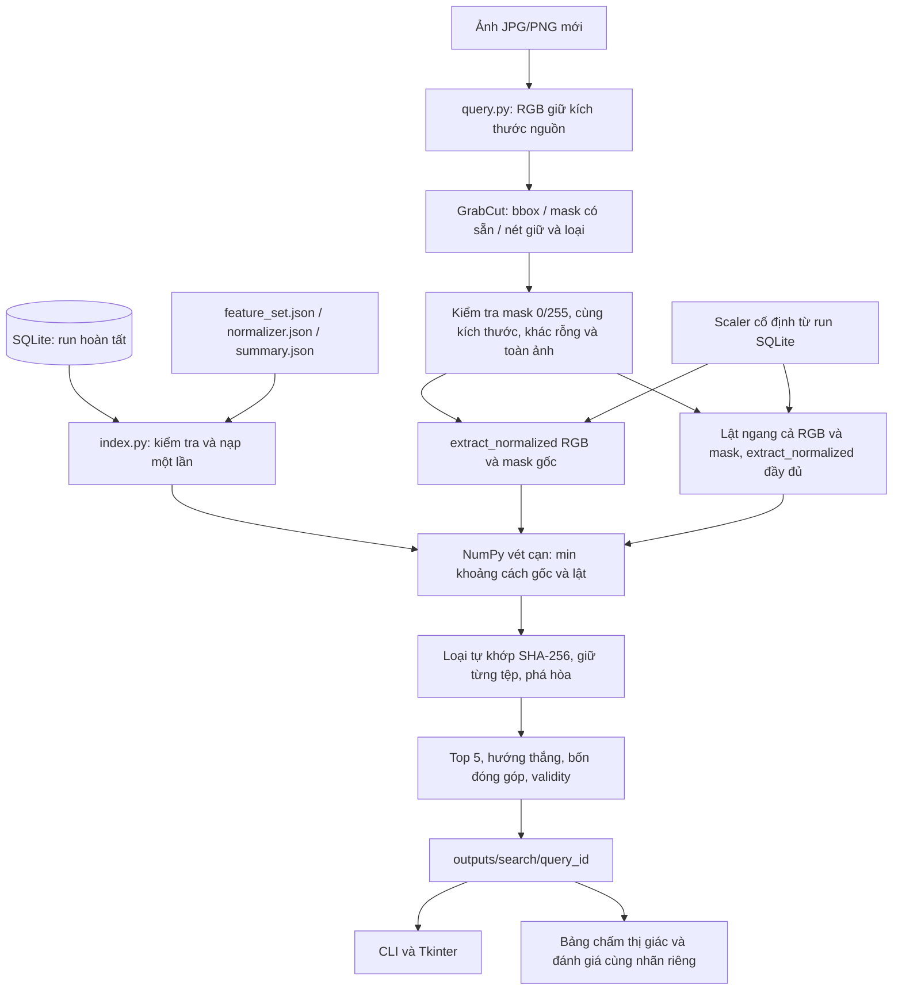
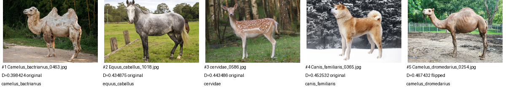

# Yêu cầu 4 — Tìm 5 tệp ảnh tương đồng bằng B400 hiện hành

Xem thêm [kiểm tra chất lượng ngày 23/10](search_quality_audit.md) cho phân tích
các lượt người dùng, các sửa lỗi bbox/mask và công cụ `diagnose`.

Triển khai và chạy trên Mac Intel, Python 3.10.11 trong `.venv/`, NumPy
1.26.4, OpenCV 4.11.0, Pillow 12.3.0, Tk 8.6. Không thêm phụ thuộc, không đổi
requirements, mã B400, công thức S2e/S3, scaler hoặc SQLite. Các tài liệu yêu
cầu 1–3 là hồ sơ lịch sử và được giữ nguyên. Ngày chạy: **22/10/2026**.

## Kiến trúc và dữ liệu vào/ra



| Module | Đầu vào | Chức năng | Đầu ra |
|---|---|---|---|
| [`index.py`](../../tools/search/index.py), `SearchIndex` | Thư mục B400, `run_id` tùy chọn, root dự án | Mở SQLite `mode=ro`, snapshot nhất quán; kiểm tra run/config/scaler/vector/metadata; nạp một lần | Ma trận NumPy `N×400 <f4` chỉ đọc; đường dẫn, hash, nhãn, mask, validity 400 bit, quality, quyết định duyệt/cờ lịch sử; ID run/scaler |
| `index.py`, `rank` | Ma trận, 2 vector chuẩn hóa 400 chiều, hash truy vấn | Vét cạn chính xác, chọn hướng riêng từng ứng viên, giữ từng tệp và phá hòa | Tối đa 5 kết quả, tổng/bốn khoảng cách, hướng, số tệp/nội dung và lý do thiếu |
| [`query.py`](../../tools/search/query.py), giải mã/mask | Bytes JPG/PNG; mask PNG hoặc bbox/nét tô | RGB uint8 kích thước nguồn, GrabCut, kiểm tra mask; tái dùng công cụ cũ | `QueryImage`, mask `H×W uint8`, nguồn/hash/phương pháp/thời gian mask |
| `query.py`, `retrieve` | Index, `QueryImage`, mask, provenance | Gọi B400 cố định cho gốc/lật, tìm kiếm và xuất trung gian | `result.json`, `vectors.npz`, ảnh/mask/overlay/preview/cấu hình/ảnh top 5 trong thư mục riêng |
| [`cli.py`](../../tools/search/cli.py) | Tham số dòng lệnh | `status`, `query`, `gui`, `batch`, `score`, `diagnose` | JSON/log, thư mục kết quả, mã thoát |
| [`gui.py`](../../tools/search/gui.py) | Thao tác Tkinter | Chọn ảnh tự tạo mask, tô giữ/loại, hoàn tác, tìm, xem chi tiết và xuất | Cùng cấu trúc kết quả CLI; widget chỉ cập nhật trên luồng Tk |
| [`evaluation.py`](../../tools/search/evaluation.py) | Manifest CSV ảnh mới; bảng relevance do người chấm cung cấp | Truy vấn theo lô bằng một index/scaler, bảng chấm, P@5 và tổng hợp | `batch.json`, `judgments.csv`, `evaluation.json`, `per_query.csv`, `per_group.csv` |

`SearchIndex` không nạp ứng viên theo nhãn, giống hoặc tên tệp. Tên tệp chỉ
tham gia phá hòa sau khi tính khoảng cách. Nhãn chỉ phục vụ hiển thị/đánh giá.
Ảnh chưa có nhóm nhãn tương ứng trong CSDL vẫn đi qua cùng luồng tìm kiếm.

## Chọn run và kiểm tra tính tương thích

Mặc định lấy `summary.json.run_id`; có thể chỉ rõ `--run-id` trước tên lệnh.
Run phải `complete`, có `completed_at`, đầy đủ status thành công và vector.
Các bản ghi phải khớp **cả run_id, feature_set_id, normalizer_id**, dimensions=400,
dtype=`<f4`. Kiểm tra SQLite integrity/FK, kích thước BLOB, NaN/Inf, validity
0/1, đường dẫn an toàn/hiện diện và hash metadata nhất quán.

Cấu hình SQLite phải bằng cấu hình/mã/runtime của B400 hiện hành và sidecar
`feature_set.json`. Scaler kiểm tra checksum/ID, phiên bản, cấu hình/rules,
400 tham số hữu hạn, scale dương, digest tập fit và số dòng fit. Với run hiện
hành, ID và sidecar `normalizer.json` phải khớp summary/SQLite. Khi chọn run
hoàn tất cũ, lấy scaler của chính run đó từ SQLite; không áp scaler của summary
lên vector cũ. Việc tái hiện chuẩn hóa từ raw/validity đã lưu được kiểm tra
cho mọi vector; không fit lại hoặc trích lại ảnh CSDL. Lỗi trả thông báo rõ,
không xây lại đặc trưng hoặc tự chọn run khác.

Run thực tế:

```text
run_id       2c3cf6b3827ef7ffd71c7d5d6d6c4b9da9c2e4622f06eb2bf2e6e1000f923804
feature_set  35c929107f151144f09ce058e6859c808bd14f21acd25a28c7842f3b46792338
normalizer   fe02f456dfcedeeeff57f56d1bc610127c5ecb28cb364c7268383c572058e6e4
```

Số lượng nạp được tính từ bản ghi: **812 tệp**; cả 812 tệp đều có vector và
được xét riêng khi tìm kiếm. Hai cặp tệp có cùng SHA-256. Mã không gắn cứng 812.
Thời gian nạp/kiểm tra trong lần chạy lô là 3,539 giây, thực hiện
một lần rồi dùng lại cho bốn truy vấn.

## Luồng ảnh mới và tạo mask

Pillow giải mã đầy đủ một frame JPEG/PNG, chuyển RGB; không tự xoay EXIF hoặc
biến đổi ICC, thống nhất hệ tọa độ pixel đã lưu của B400. Không kéo ảnh mới
thành 576×384. Mask nạp phải PNG grayscale `L`/`1`, cùng kích thước, nhị phân
0/255, có cả tiền cảnh và nền; không tự threshold mask xám sai định dạng.

CLI không chỉ định bbox: tái dùng `run_grabcut.create_foreground_mask`, gồm bbox
cách biên 10 pixel và morphology hiện có. Có bbox: dùng GrabCut rectangle ở
kích thước nguồn với seed=0, 5 vòng mặc định. GUI không có nút nạp mask PNG hoặc
thao tác kéo bbox. Khi chọn ảnh trùng SHA-256 với ảnh CSDL, GUI tự dùng mask
đã lưu sau khi kiểm tra hash; ảnh mới dùng bbox tự động/GrabCut hiện có.
Mask tạo xong có thể
tô giữ=1, loại=0, chưa tô=255; `edit_masks.refine_mask` tái dùng probable labels
từ mask và hard labels từ nét tô. Không sửa các công cụ phân đoạn cũ.

GUI hiển thị ảnh gốc, mask và overlay nền đỏ; hỗ trợ bán kính bút, hoàn tác và
chặn tìm kiếm khi nét tô mới chưa áp dụng. Áp dụng GrabCut cần nét tô mới.
Nút **Chọn ảnh khác** mở hộp chọn tệp; chọn ảnh mới xóa kết quả lượt trước
và tự tạo mask mới, còn hủy chọn giữ nguyên.
CLI vẫn hỗ trợ mask/nét tô dạng PNG để tái
lập. Nét tô phải cùng kích thước và đúng nhãn, không âm thầm chuyển màu.

Mỗi hướng gọi `extract_normalized(rgb, mask, saved_scaler)` đầy đủ. Hướng lật
dùng đồng thời `rgb[:, ::-1]` và `mask[:, ::-1]`; không suy hướng đầu từ tên
ảnh/nhãn, không chỉ đảo tọa độ vector. Canvas tiền cảnh lấy bằng `b400.prepare`:
bbox toàn tiền cảnh, co đều/đệm 288×192. S2e đo trên mask nguồn; S3 vẫn dùng
canvas 256×192, lưới nhị phân 6×8 ô vuông 32×32, ngưỡng >15% của B400 hiện hành.

## Khoảng cách, ảnh trùng và giải thích

Với vector chuẩn hóa cố định:

```text
D(q,x)       = sum_i (v_q[i] - v_x[i])²
D_final(q,x) = min(D(q_original,x), D(q_flipped,x))
```

Tích lũy bằng float64 trên giá trị float32 đã lưu. Trọng số nhóm đã nằm trong
vector chuẩn hóa; không nhân thêm 1/4. Validity giữ để giải thích phép đo thiếu,
không đổi khoảng cách theo phần hợp lệ chung của từng cặp. Không chuyển khoảng
cách thành xác suất đúng loài và không hiển thị điểm xác suất.

Khoảng cách nhỏ đứng trước. Hòa khoảng cách dùng thứ tự Unicode của filename,
rồi path và hash; gốc/lật hòa chọn gốc. Mỗi tệp là một ứng viên: hai tệp có
cùng SHA-256 vẫn có thể cùng xuất hiện trong top 5 nếu đủ gần. Mặc định loại
**mọi tệp** có hash bytes bằng ảnh truy vấn trước khi chọn top 5;
`--include-self` cho phép giữ các tệp đó. Không xóa/sửa bản ghi CSDL. Nếu còn
dưới 5 tệp hợp lệ, trả số thực và `shortfall_reason`, cùng số tệp và số hash
duy nhất trước/sau loại. Chế độ gộp theo hash chỉ dùng để kiểm tra lại các
lượt tìm kiếm đã lưu trước khi thay đổi này.
Trong GUI, chọn **Hiện cả ảnh trùng truy vấn** có cùng tác dụng với
`--include-self`; mặc định bỏ chọn khi mở ảnh truy vấn khác.

Hash là SHA-256 bytes tệp, không phải hash thị giác. Ảnh mã hóa lại, cắt hoặc
resize có thể khác hash dù cùng nguồn. Ví dụ ảnh dẫn xuất 864×576 bên dưới
vẫn tìm được ảnh gốc; vì vậy nó được đánh dấu kiểm tra chức năng, không phải
truy vấn độc lập để đánh giá chất lượng.

Với từng kết quả, lấy đúng vector gốc/lật đã thắng để tính đóng góp màu
`[0:48]`, kết cấu `[48:148]`, hình dạng `[148:272]`, bố cục `[272:400]`. Có kiểm
tra tổng bốn phần bằng khoảng cách tổng trong sai số số học.

## Trung gian và kết quả chạy thực tế

Các artifact ngày 22/10 bên dưới được tạo theo quy tắc cũ: mỗi SHA-256 chỉ
hiển thị một tệp. Chúng được giữ nguyên để đối chiếu lịch sử; lượt tìm mới
hiển thị từng tệp theo quy tắc hiện tại.

Kiểm tra lượt mới với `equus-quagga_0663.jpg` và tùy chọn `--include-self`:
[kết quả đã lưu](../../outputs/search/20261023T022920_325538Z_bb862978/result.json)
cho hạng 1 là `equus-quagga_0663.jpg`, hạng 2 là
`equus-quagga_0667.jpg`, cả hai có khoảng cách **0**. Chúng là hai tệp riêng,
cùng SHA-256. Mặc định không bật `--include-self` thì cả hai bản cùng hash với
truy vấn đều bị loại theo quy tắc tự khớp.

Ví dụ dùng `Equus_asinus_0587.jpg` và mask đã duyệt, loại tự khớp. Đây là kiểm
tra chức năng bằng ảnh CSDL, không phải kết quả đánh giá độc lập. Thư mục:
[`20261022T153956_195301Z_7ea40f22`](../../outputs/search/functional_checks/20261022T153956_195301Z_7ea40f22/).

| Trung gian | Giá trị thật |
|---|---|
| Ảnh nguồn | RGB 576×384; SHA-256 `5f01ff2639e087739f9631f9bbece8de697aacc8ff2a105d6f9bb1825e1fa080` |
| Bbox toàn tiền cảnh nguồn | `[119,9,341,361]` (x,y,width,height) |
| Canvas chính | 288×192; chủ thể 181×192, offset `[53,0]` |
| Canvas S3 | 256×192; chủ thể 181×192, offset `[37,0]` |
| S2e raw tại 159 | 1,3539928198; major=469,7765 pixel, minor=346,9564 pixel |
| Validity gốc/lật | 378/400 ở mỗi hướng; các chiều còn lại giữ quy ước của B400 |
| Norm vector gốc/lật | 1,0 / 0,99999994 (float32) |
| Loại trùng hash truy vấn | 1 tệp; trả 5 nội dung |

| Hạng | Tệp | Nhãn metadata | D_final | Hướng truy vấn thắng |
|---|---|---|---:|---|
| 1 | Camelus_bactrianus_0463.jpg | camelus_bactrianus | 0,398423758 | original |
| 2 | Equus_caballus_1018.jpg | equus_caballus | 0,434874510 | original |
| 3 | cervidae_0586.jpg | cervidae | 0,443485929 | original |
| 4 | Canis_familiaris_0365.jpg | canis_familiaris | 0,452532336 | original |
| 5 | Camelus_dromedarius_0254.jpg | camelus_dromedarius | 0,467431512 | flipped |

Đóng góp hạng 1: màu **0,0297689710**, kết cấu **0,0269252476**, hình dạng
**0,2687322150**, bố cục **0,0729973242**; tổng đầy đủ
**0,3984237578057769**. Các kết quả khác nhãn vẫn được trả bình thường.
Chưa có người chấm mức tương đồng thị giác cho những kết quả này.



Lần chạy theo lô có manifest
[`functional_queries.csv`](../../outputs/search/functional_queries.csv), thư mục
[`batch_20261022T154444_232219Z_9268a9`](../../outputs/search/functional_checks/batch_20261022T154444_232219Z_9268a9/).
Các thời gian dưới là đo một lần trên CPU, không phải benchmark hiệu năng.
Nạp mask đo riêng, không được gọi là thời gian tạo mask.

| Truy vấn chức năng | Kích thước | Tạo mask (s) | Nạp mask (s) | Hai đặc trưng + preview (s) | Tìm kiếm (s) | Tự khớp bị loại | Kết quả |
|---|---|---:|---:|---:|---:|---:|---:|
| database_donkey | 576×384 | 0 | 0,0042 | 0,6668 | 0,0079 | 1 | 5 |
| duplicate_hash, equus-quagga_0663.jpg | 576×384 | 0 | 0,0040 | 0,9035 | 0,0230 | 2 | 5 |
| resized_864x576, dẫn xuất để kiểm tra hình học | 864×576 | 0 | 0,0173 | 0,9234 | 0,0108 | 0 | 5 |
| grabcut_bbox, ảnh CSDL nhưng tạo mask mới | 576×384 | 6,1248 | 0 | 0,5058 | 0,0080 | 1 | 5 |

Mỗi thư mục query có:

| Tệp | Nội dung |
|---|---|
| `input.jpg` hoặc `input.png` | Bytes ảnh đầu vào nguyên vẹn, hash dùng loại tự khớp |
| `query_rgb.png`, `mask.png`, `overlay.png` | RGB giải mã và mask thực sự sử dụng, overlay xem trước |
| `strokes.png` nếu có | Nét giữ/loại; GUI ghi lịch sử số pixel/hash/thời gian từng lần refine |
| `foreground_original.png`, `foreground_flipped.png` và `foreground_mask_*.png` | Tiền cảnh theo đúng `B400.prepare`, không có pipeline resize thay thế |
| `vectors.npz` | `original_raw`, `original_normalized`, `original_validity`, ba mảng tương ứng `flipped_*`; mỗi mảng 400 phần tử, đọc `allow_pickle=False` |
| `configuration.json` | Cấu hình B400, scaler đầy đủ và run/ID/provenance, quy tắc tìm kiếm |
| `result.json` | Query/hash, quality của hai hướng, mask/provenance, số ứng viên, chính sách, top 5, đóng góp, validity và thời gian từng giai đoạn |
| `results/1.jpg` … | Bản sao ảnh kết quả hiển thị; kiểm tra SHA-256 với CSDL trước khi lưu |
| `top5.png` | Bảng ảnh xem nhanh với hạng, khoảng cách, hướng và nhãn metadata |

Lưu từng query_id UTC + hậu tố UUID, không ghi đè lượt cũ. `result.json` ghi sau
cùng; thư mục thiếu tệp này là xuất chưa hoàn tất. Xuất GUI sao chép toàn bộ
lượt sang thư mục khác trong `outputs/search/`, từ chối ghi đè/đệ quy. Tất cả
lệnh ghi bị giới hạn trong `outputs/search/`; nguồn ảnh/mask và B400 được đọc.

## Công cụ đánh giá độc lập

Chưa có tập truy vấn mới độc lập hoặc relevance do nhóm chấm, nên P@5 thị giác
thực tế **để trống/null**. Bốn truy vấn chức năng và lượt GUI không được dùng
công bố độ chính xác/hiệu quả truy hồi. Công cụ không tự suy relevance từ nhãn.

Manifest CSV UTF-8, một dòng/query; đường dẫn tương đối tính từ thư mục chứa
manifest. Mẫu header ở
[`query_manifest_template.csv`](../../tools/search/query_manifest_template.csv).

| Cột | Cách dùng |
|---|---|
| query_id | Bắt buộc, không rỗng, duy nhất |
| image | Bắt buộc, ảnh JPG/PNG mới |
| mask | Mask PNG tùy chọn; để trống để tạo GrabCut |
| label | Nhãn do nhóm cung cấp, tùy chọn; chỉ dùng đối chiếu cùng nhãn |
| group | Nhóm tổng hợp do nhóm cung cấp; mặc định label hoặc `(unlabelled)` |
| purpose | `independent` khi nhóm xác nhận ảnh mới độc lập; `functional_check` để kiểm tra kỹ thuật; bỏ trống là `unverified` |
| x,y,width,height | Bbox tùy chọn nếu không nạp mask; tọa độ nguồn |
| strokes | PNG nhãn 0/1/255 tùy chọn để refine mask |

Hash truy vấn nằm trong CSDL luôn bị chuyển thành `functional_check` dù CSV
ghi `independent`. Ảnh dẫn xuất khác hash cần nhóm khai báo trung thực; không
có phát hiện trùng thị giác tự động. Một index, cấu hình và scaler dùng chung
cho cả batch; lỗi một ảnh ghi tên/lý do/thời gian, không dừng các ảnh còn lại.

`judgments.csv` chứa ảnh truy vấn/mask và đường dẫn từng kết quả, ID, rank,
hash, khoảng cách/hướng, nhãn riêng. Nhóm chỉ sửa `visual_relevant` thành **0/1**
và `notes`; bỏ trống nếu chưa chấm. Không xóa dòng. `score` kiểm tra trùng dòng,
rank lạ, thiếu dòng, hash/identity/metadata bị sửa và relevance ngoài 0/1.

`P@5 = số kết quả có visual_relevant=1 / 5` chỉ được tính nếu trả đủ 5, cả 5 đã
chấm và purpose=independent. Thiếu kết quả/thiếu chấm/lỗi không gán bằng 0.
`same_label_at_5` là số nhãn bằng nhãn truy vấn / 5 trên truy vấn độc lập có đủ
kết quả và nhãn, báo riêng; không có nghĩa phù hợp thị giác. Tổng hợp theo query,
group và toàn bộ dùng trung bình macro các query đủ điều kiện, ghi rõ mẫu số,
số query độc lập/chức năng/chưa xác nhận/lỗi và thời gian. Nhóm chưa có query
đủ điều kiện vẫn có dòng với metric để trống.

### Chấm batch sau khi clone hoặc di chuyển

Batch mới có `artifact_paths_version=2`. `result_json` và ba cột đường dẫn ảnh
trong `judgments.csv` được lưu tương đối từ thư mục chứa `batch.json`, theo dạng
`queries/ARTIFACT_QUERY_ID/result.json`. `query_id` ở batch là ID do manifest đặt
(ví dụ `database_donkey`); `artifact_query_id` là ID thời gian/UUID của lượt tìm.
Hai ID được liên kết rõ bằng bản ghi batch, không ép chúng phải cùng chuỗi.
Bản ghi mới còn lưu SHA-256 của result.json để phát hiện nội dung bị sửa.

Khi chấm, `resolve_result` chỉ mở artifact trong chính batch đang mở, xác minh
ID thư mục/result/binding, ID run/feature/scaler, số kết quả, thứ tự rank và
checksum nếu có. Chặn `..`, sai cấu trúc và symlink/đường dẫn thoát phạm vi.
Không mở đường dẫn từ CSV. Ngoài identity/nhãn, các cột ảnh, khoảng cách, hướng
và same_label đều được kiểm tra; chỉ relevance và notes được phép chỉnh.

Với batch lịch sử, chỉ ánh xạ đuôi
`.../outputs/search/.../batch_*/queries/ID/result.json` sang `queries/ID/result.json`
cục bộ. Artifact cục bộ phải có query_id=ID, output_directory đúng thư mục gốc
được ghi trong đường dẫn cũ và các ID index khớp batch. Thiếu hoặc không xác định
chắc được artifact thì lỗi rõ; **không mở đường dẫn tuyệt đối gốc**, kể cả khi
nó còn tồn tại. Hồ sơ lịch sử không có checksum mới nên phép kiểm tra là tính
nhất quán nội bộ, không phải xác thực chống sửa đồng thời mọi tệp.

Sao chép toàn bộ một batch rồi chấm tại đích (đích xuất phải trong outputs/search):

```sh
cp -R outputs/search/functional_checks/batch_20261022T154444_232219Z_9268a9 \
  outputs/search/my_batch_copy
.venv/bin/python -B tools/search/cli.py score \
  --batch outputs/search/my_batch_copy/batch.json \
  --judgments outputs/search/my_batch_copy/judgments.csv \
  --output-dir outputs/search/my_batch_copy/scored
```

Không sửa đường dẫn trong bảng chấm lịch sử. Khi xem ảnh lịch sử sau khi chuyển,
dùng thư mục cục bộ `queries/ID/query_rgb.png`, `mask.png`, `results/1.jpg`…;
đường dẫn tuyệt đối trong CSV được giữ như bằng chứng nguồn cũ. Batch mới mở
ảnh theo đường dẫn tương đối tính từ batch. `score` chỉ cần artifact batch,
không cần nạp SQLite, ảnh Downloads cũ hoặc trích xuất lại B400. Tạo `.venv/`
tại clone mới theo README; không sao chép venv từ máy khác.

Kiểm chứng thực tế: [hai bản sao batch](../../outputs/search/verification/completion_checks.json)
đều có 4/4 truy vấn chức năng, chấm lại khớp toàn bộ tổng hợp gốc, file nguồn
và file sao chép giữ nguyên bytes. P@5 thị giác vẫn null vì chưa có chấm độc lập.
58 kiểm thử tìm kiếm/phân tích và 30 hồi quy B400 đạt trong `.venv/` Mac Intel;
bao gồm hồi quy include-self/trùng hash, gộp hash cũ, di chuyển, thoát phạm vi,
symlink, artifact thiếu và metadata/checksum bị sửa.

### Phân tích từng nhóm và bỏ từng nhóm

Lệnh `.venv/bin/python -B -m tools.search.group_analysis` dùng cùng hai vector
query và 812 vector corpus đã lưu cho full + bốn nhóm riêng + bốn ca bỏ nhóm.
Không đổi scaler, không nhân trọng số lần hai hoặc chuẩn hóa lại đoạn vector.
Định nghĩa D_S, quy tắc chọn sớm nhất mỗi họ ngựa/bò/chó, Top 5, khoảng cách,
hạng ứng viên tham chiếu và mask được ghi trong
[báo cáo thí nghiệm](../../outputs/search/diagnostics/group_analysis/20261023T133848_225643Z_20473d/README.md).
Có 135 dòng Top 5 và 12 cặp được quan sát trực tiếp bởi trợ lý, ghi riêng với
relevance nhị phân còn trống. Thay đổi thứ hạng không chứng minh cải thiện
phù hợp thị giác; chưa có chấm đầy đủ và tập độc lập để kết luận điều đó.

## Kiểm thử, kiểm chứng thực tế và giới hạn

**110 kiểm thử đạt:** 35 tìm kiếm mới + 30 B400/SQLite + 21 validation + 24 công
cụ ảnh (môi trường `.venv-image-tools/` như trước). Test mới bao phủ vector biết
trước, top 5/phá hòa, hướng gốc/lật và hòa, tổng bốn đóng góp, không nhân lại
trọng số, nhãn không đổi điểm, validity không đổi metric, trùng hash/tự khớp/
dưới 5/0 ứng viên, đúng run/scaler kể cả run cũ, sai cấu hình/runtime, checksum,
NaN/validity sai, vector/tệp thiếu, ảnh/mask/nét tô lỗi, GrabCut hard labels,
pipeline hai trích xuất đầy đủ và xuất artifact, lỗi batch, nhóm mới, P@5 và
tổng hợp có đáp án biết trước, relevance chưa chấm và dữ liệu chấm sai.

Kiểm thử tạo scaler trên fixture tổng hợp trong thư mục tạm, không dùng chúng
làm kết quả đánh giá truy hồi và không thay scaler thật. Mọi truy vấn thực tế
dùng scaler đã lưu. Các log nằm trong
[`verification/`](../../outputs/search/verification/). Bộ mã `tests/` và các script xác minh trong đó đã được gỡ khỏi nhánh hiện tại; số lần đạt và log dưới đây chỉ phản ánh các lần chạy trước đó, không còn tái chạy được từ checkout này.

Đã mở **cửa sổ Tkinter thật** và chạy tự động 16 nhóm kiểm tra: nạp SQLite qua
worker, chọn ảnh tự dùng mask CSDL cùng hash hoặc tạo GrabCut với bbox tự động,
không còn nút nạp mask/kéo bbox, nét giữ/loại, chặn nét chưa áp dụng, hoàn tác/
refine, chặn tìm kiếm chồng, top 5, đóng góp/vector/validity, xuất, hiển thị
lỗi worker, tùy chọn hiện ảnh tự khớp và đổi ảnh truy vấn. Xem
[`gui_smoke.json`](../../outputs/search/verification/gui_smoke.json).
Chưa duyệt GUI thủ công hoặc kiểm tra ảnh chụp cửa sổ; không tuyên bố đã làm.

Script `verify_real_run.py` (đã gỡ khỏi nhánh hiện tại) từng đọc lại các lượt
thật, trích hai hướng bằng scaler cố định để đối chiếu raw/normalized/validity,
preview/quality; tính lại khoảng cách bằng vòng lặp scalar độc lập với hàm rank,
đối chiếu thứ tự/hướng/chính sách trùng hash/tự khớp, đóng góp và hash bản sao ảnh kết quả.
Gồm cả bản xuất GUI; kiểm chứng toàn bộ artifact hiện có. Đây là
kiểm chứng kỹ thuật, không phải chấm relevance.

SHA-256 được ghi trước khi triển khai cho **6.118 tệp** trong `data/`, toàn bộ
`outputs/inventory/`, `outputs/segmentation/`, `outputs/features/b400_v1/`, mọi
tài liệu cũ và mã B400/phân đoạn. Sau chạy đối chiếu từng tệp: không sửa/xóa,
không thêm ngoài dự kiến; chỉ thêm báo cáo yêu cầu 4 trong vùng docs. Bằng chứng
[`protected_before.json`](../../outputs/search/verification/protected_before.json)
và [`delivery_checks.json`](../../outputs/search/verification/delivery_checks.json).
Không chạy verifier yêu cầu 3 vì lệnh đó ghi `verification.json` trong B400.

Giới hạn: chất lượng mask phụ thuộc người sửa; B400 cố định nhạy tư thế/khuyết
phép đo và có thể ưu tiên hình dạng hơn nhãn (như ví dụ thật). Trọng số không
được tối ưu trong yêu cầu này. Quy tắc SHA-256 chỉ xử lý tự khớp bytes, chưa xử lý ảnh cùng
nội dung nhưng mã hóa khác. Tìm vét cạn phù hợp quy mô hiện tại, chưa benchmark
tập lớn. GUI/CLI được kiểm tra trên Mac Intel; chưa kiểm chứng Windows hoặc
máy khác phiên bản runtime. Không có ground truth phân đoạn/relevance mới để
đánh giá IoU hoặc độ phù hợp thị giác.

## Lệnh sử dụng và tái lập

Chạy từ root repo, dùng `.venv/` hiện có; không chạy extract/rebuild B400.

```sh
# Nạp/kiểm tra run hiện hành; tùy chọn run đặt trước tên lệnh.
.venv/bin/python -B tools/search/cli.py status
.venv/bin/python -B tools/search/cli.py --run-id 2c3cf6b3827ef7ffd71c7d5d6d6c4b9da9c2e4622f06eb2bf2e6e1000f923804 status

# Ví dụ thật với mask có sẵn; tự khớp bị loại mặc định.
.venv/bin/python -B tools/search/cli.py query \
  --image data/cropped_images_576x384/Equus_asinus_0587.jpg \
  --mask outputs/segmentation/grabcut/masks/Equus_asinus_0587.jpg.png

# Ảnh mới: đổi đường dẫn và bbox theo kích thước thật.
.venv/bin/python -B tools/search/cli.py query --image /path/new.jpg --bbox 10 10 500 300
.venv/bin/python -B tools/search/cli.py gui

# Batch kiểm tra chức năng hiện có.
.venv/bin/python -B tools/search/cli.py batch --manifest outputs/search/functional_queries.csv

# Batch ảnh độc lập: sao chép header, bổ sung các dòng dữ liệu thật trước khi chạy.
cp tools/search/query_manifest_template.csv outputs/search/new_queries.csv
.venv/bin/python -B tools/search/cli.py batch --manifest outputs/search/new_queries.csv

# Sau khi người chấm điền relevance 0/1: thay BATCH bằng thư mục batch vừa in ra.
BATCH=outputs/search/functional_checks/batch_20261022T154444_232219Z_9268a9
.venv/bin/python -B tools/search/cli.py score \
  --batch "$BATCH/batch.json" --judgments "$BATCH/judgments.csv" \
  --output-dir outputs/search/scored

```

CLI cũng hỗ trợ `python -B -m tools.search.cli`; mã thoát 0=hoàn tất,
1=batch có query lỗi (vẫn có báo cáo), 2=lỗi cấu hình/đầu vào/thao tác. Đầu ra
mặc định `outputs/search/`; `--output-dir` phải bên trong đó. Thời gian tạo mask,
nạp mask, trích đặc trưng, tìm kiếm và nạp index tách riêng; không bao gồm thời
gian người dùng sửa mask vào thời gian tính toán. Không tự commit hoặc push.

Để hoàn tất đánh giá độc lập, nhóm cần bổ sung **ảnh truy vấn mới** (có cả nhóm
đã có/chưa có trong CSDL), **mask đã kiểm tra** hoặc bbox/nét sửa, nhãn/group do
nhóm xác nhận, khai báo tính độc lập của ảnh và **relevance thị giác 0/1 cho từng
kết quả** theo tiêu chí thống nhất. Để kiểm tra độ nhất quán người chấm, nhóm
có thể chấm độc lập rồi thống nhất bất đồng trước khi xuất số cuối.
