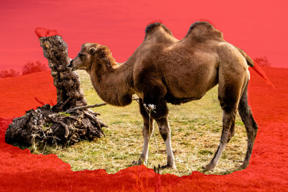
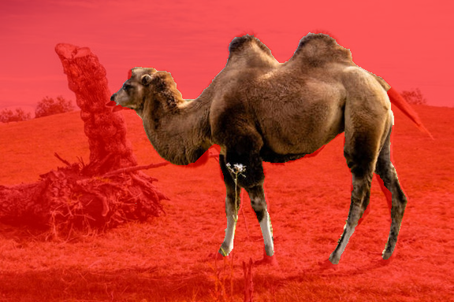

# Kiểm tra chất lượng tìm kiếm và mask — 23/10/2026

> Phạm vi nhánh tinh gọn: đã gỡ dữ liệu thử, bản sao và log trung gian. Các số kiểm thử/artifact là kết quả lịch sử trước khi dọn; giữ kết quả phân tích cuối và tám lượt minh họa. Liên kết tới chứng cứ đã gỡ trỏ về commit gốc trên GitHub, không phải tệp trong checkout này.

Mục tiêu người dùng đã xác nhận: ưu tiên **dáng, màu và họa tiết**, cho phép kết
quả khác loại động vật. Vì vậy, khác nhãn không được tính là truy hồi sai. Bài
kiểm tra này dùng các lượt thực tế đã lưu trong `outputs/search/`, B400 400 chiều
và scaler/SQLite hiện hành; không fit hoặc thay đặc trưng yêu cầu 3.

## Kết luận từ dữ liệu thực tế

Audit công cụ đã được sửa để đọc self_match và duplicates của từng lượt,
dùng chung parser với `diagnose`; bản trước gọi chính sách mặc định nên không
đủ để kiểm chứng include-self hoặc gộp hash lịch sử. Lần kiểm tra bổ sung tái
tạo chính xác **50/50 artifact hiện có trước khi tạo batch kiểm chứng**; lần
cuối **62/62**, gồm 12 artifact trong các batch mới/bản sao, **0 không khớp**.
Chuẩn hóa raw/validity với scaler cố định khớp **124/124 vector** ở lần cuối.
Số lượt được tính động và ghi cả đường dẫn artifact, không coi bản xuất là
truy vấn độc lập. [Bằng chứng đầy đủ](../../outputs/search/diagnostics/search_audit/evidence_20261023T133817_524683Z_002c30.json)
giữ chính sách, kết quả đã lưu/tái tạo và lý do từng sai khác nếu có.
Bốn trường hợp trích xuất lại
từ RGB và mask cũng khớp vector đã lưu. Hai nguyên nhân đã đo được là mask
đo sai vùng chủ thể và độ nhạy/giới hạn của biểu diễn B400.

### Mask đang đo cả nền hoặc thiếu bộ phận

| Lượt đã lưu | Quan sát overlay | Diện tích tiền cảnh | Agreement IoU với mask dùng khi xây CSDL | D² giữa query và vector của chính ảnh đó trong CSDL |
|---|---|---:|---:|---:|
| Camelus0057, 08:45:42 | Giữ cả gốc cây/cỏ cạnh con vật | 50,3% | 0,4252 | 0,8988 |
| Cùng ảnh, sau tô sửa, 08:47:16 | Loại gốc cây và phần cỏ thừa | 22,1% | 0,9182 | 0,1600 |
| Canis0355, 08:49:53 | Mất phần đầu/cổ, còn mảng cỏ rời | 20,8% | 0,6093 | 0,4621 |
| Canis0470, 08:49:01 | Mask trùng mask dùng xây CSDL | 29,5% | 1,0000 | 0,0000 |

Giờ trong bảng là giờ Việt Nam. Mask CSDL là mốc kỹ thuật đã được duyệt, chưa
phải ground truth độc lập. IoU trong bảng chỉ là **mức giống nhau giữa hai
mask**, không phải độ chính xác phân đoạn. D² nhỏ hơn không tự chứng minh
kết quả phù hợp thị giác hơn.

Ảnh lạc đà trước và sau khi người dùng tô sửa:





Ảnh bò ngoài CSDL `Bos_taurus_001.jpg` bị mất chân dưới trong cỏ. Không có
hash trùng nên không tính agreement với mask CSDL cho ảnh này.
Trong 22 lượt phân tích ban đầu, **21 lượt dùng bbox mặc định gần toàn khung**, một
lượt nạp mask; không lượt nào ghi nhận bbox do người dùng chọn. GUI cũ cho
bấm “Tạo mask từ bbox” khi chưa kéo bbox nên hành vi này không rõ ràng.

GrabCut dùng phân bố màu và nét giữ/loại, không tự xác định đủ các bộ phận
con vật. Ngoài bbox khởi tạo được coi là nền chắc chắn; bbox cần bao đủ đầu,
tai, sừng, chân và đuôi, đồng thời tránh vật phụ bên cạnh nếu có thể. Nền có
màu gần chủ thể vẫn cần tô sửa. Xem [hướng dẫn GrabCut của OpenCV](https://docs.opencv.org/4.10.0/d8/d83/tutorial_py_grabcut.html).

### B400 khuếch đại thay đổi của mask

B400 lấy bbox bao **mọi thành phần tiền cảnh**. Mảnh nền ở xa làm đổi bbox,
kích thước chủ thể, padding và vị trí ô lưới. Cả hình dạng, màu, kết cấu và
bố cục sau chuẩn hóa có thể cùng thay đổi.

Thí nghiệm cùng bbox/seed/5 vòng, so raw GrabCut với morphology hiện có cho
bốn ảnh, không sửa dữ liệu nguồn:

- Chỉ một pixel rời ở ảnh bò làm chiều cao bbox **206 → 281 pixel**; D² giữa
  hai vector là **0,2872** dù số pixel thay đổi rất nhỏ.
- Bỏ morphology không khôi phục được đầu chó hoặc chân bò, cũng không tự
  loại được cây/cỏ của ảnh lạc đà. Hiệu quả giữa bốn ảnh không nhất quán.
- Vì vậy, không thay hàng loạt mask hoặc âm thầm bỏ morphology mặc định.
  CLI tự động tiếp tục kế thừa công cụ cũ; nhánh bbox tương tác giữ đầu ra
  GrabCut để người dùng kiểm tra và tô sửa.

Phép opening/closing có thể loại chi tiết mảnh hoặc nối vùng; đây không phải
bộ nhận biết bộ phận động vật. Tham khảo [OpenCV về morphology](https://docs.opencv.org/4.13.0/d9/d61/tutorial_py_morphological_ops.html).

### Đúng công thức vẫn có giới hạn về cảm nhận thị giác

Norm mỗi nhóm B400 là 0,5, tương ứng trọng số năng lượng 25%. Điều đó chưa
đảm bảo ảnh hưởng đến thứ hạng giống nhau: nhóm histogram không âm có phân
bố khác các nhóm z-score có cả dấu âm. Với Canis0355, trung vị D² tới các
ứng viên ở bản gốc lần lượt là màu **0,0725**, kết cấu **0,3078**, hình dạng
**0,4754**, bố cục **0,1260**. Đây là phép đo phân bố khoảng cách cho một
truy vấn, không phải trọng số tối ưu hoặc đánh giá phù hợp của top 5.

S3 có 48 bit ngưỡng >15%, không lưu đầy đủ hình dáng. Thử giãn mask Canis0355
một pixel: agreement với mask ban đầu 0,9423, chỉ một bit S3 thay đổi nhưng
D² toàn vector tăng 0,03544; riêng S3 đóng 0,03022. Pipeline frozen có thể
nhạy quanh ngưỡng. Histogram/profile/lưới cũng chưa so khớp trực tiếp các
bộ phận hoặc vị trí họa tiết chi tiết giữa hai ảnh khác tư thế.

Trường hợp Canis0470 có mask đúng bằng mask CSDL nhưng kết quả vẫn cần người
xem đánh giá dáng/màu/họa tiết. Vì vậy sửa mask là cần thiết nhưng chưa đủ để
khẳng định mọi top 5 sẽ phù hợp. Không đổi weights hoặc dùng nhãn lọc kết quả
để làm số liệu có vẻ tốt hơn. Cần relevance thị giác độc lập để kiểm chứng
bất kỳ thay đổi thuật toán truy hồi tiếp theo.

## Những lỗi thao tác đã sửa

1. **GUI yêu cầu kéo bbox trước khi tạo mask.** Không âm thầm dùng gần toàn
   ảnh khi người dùng chưa chọn vùng. CLI vẫn có chế độ tự động được ghi rõ.
2. **Đổi bbox làm mask cũ trở thành chưa áp dụng.** Chặn tìm kiếm/tinh chỉnh
   bằng mask cũ đến khi tạo mask mới hoặc hoàn tác bbox; không còn trường hợp
   hiển thị khung mới nhưng đo vùng cũ.
3. **Áp dụng GrabCut cần có nét tô mới.** GUI không chạy lại khi không thay
   đổi nét tô; wrapper CLI từ chối bản strokes toàn 255. Trong dữ liệu cũ,
   một lần Apply không tô trên ảnh bò vẫn làm đổi khoảng 723–727 pixel.
4. **Hiển thị hướng dẫn kiểm tra mask trước tìm.** Diện tích, số mảnh, biên
   bbox thật và mảnh rất nhỏ làm phình bbox được ghi riêng. Cảnh báo chỉ là
   dấu hiệu kỹ thuật, không khẳng định mask đúng khi không có cờ.
5. **Nút “Dùng mask đã lưu trong CSDL”.** Chỉ dùng khi SHA-256 bytes ảnh
   trùng, kiểm tra hash mask và run; giúp so sánh nhất quán khi thử lại ảnh
   CSDL. Nhãn không tham gia tra mask hoặc xếp hạng. Ảnh mới tiếp tục dùng
   bbox và nét sửa.

B400, công thức S2e/S3, scaler và metric không đổi. Mã phân đoạn cũ không bị
sửa; mọi đầu ra audit ở `outputs/search/diagnostics/`.

## Công cụ tự chẩn đoán một lượt đã lưu

```sh
.venv/bin/python -B tools/search/cli.py diagnose \
  --query-dir outputs/search/20261023T014953_653022Z_e870cbcc
```

Đọc thư mục được in ra, mở `diagnostics.json`. Báo cáo kiểm tra hash artifacts,
ID run/config/scaler, chuẩn hóa frozen, tái tạo xếp hạng, đóng góp nhóm/khối con
và validity. Nếu có cùng hash trong CSDL, so mask đã dùng với mask đã lưu và
cho kết quả thử bằng mask đó; không tự gọi đó là kết quả tốt hơn. Với ảnh ngoài
CSDL, phần reference mask ghi chưa có thay vì tạo mốc so sánh giả.

Mã: [`diagnostics.py`](../../tools/search/diagnostics.py),
[`mask_quality.py`](../../tools/search/mask_quality.py),
[`gui.py`](../../tools/search/gui.py). Bằng chứng thực nghiệm:
[audit xếp hạng](../../outputs/search/diagnostics/search_audit/README.md),
[audit mask và ablation](../../outputs/search/diagnostics/mask_audit/README.md).

Kiểm tra tại thời điểm audit: **48 kiểm thử tìm kiếm/chẩn đoán**, **30 hồi quy B400**,
**17 nhóm kiểm tra trên cửa sổ Tk thật**. Kiểm tra sau thay đổi chính sách tệp
trùng: **49 kiểm thử tìm kiếm/chẩn đoán** và **16 nhóm Tk**. Các bản tổng kết cuối nằm trong
[`verification/`](../../outputs/search/verification/); log chi tiết đã được gỡ ở nhánh tinh gọn; kiểm tra bảo toàn nguồn
tiếp tục đối chiếu 6.118 tệp từ manifest trước triển khai. Không công bố P@5
hoặc hiệu quả truy hồi khi chưa có chấm phù hợp thị giác.

## Cách dùng giao diện hiện tại

Theo yêu cầu thao tác mới, giao diện đã bỏ nạp mask PNG và kéo bbox. Hai mục
kiểm tra bbox thủ công ở trên mô tả bản giao diện tại thời điểm audit; CLI vẫn
nhận `--bbox` hoặc `--mask` để tái lập lượt cũ. Khi chọn ảnh, giao diện tự dùng
mask CSDL nếu bytes ảnh trùng SHA-256 và hash mask hợp lệ; với ảnh khác, nó
tạo bbox cách mép ảnh 10 pixel bằng GrabCut hiện có. Đây là khung khởi tạo,
không phải bbox phát hiện chính xác con vật. Mask tự động vẫn có thể giữ nền
hoặc mất bộ phận con vật như bằng chứng ở trên, nên cần xem overlay và tô sửa.
Giao diện hiện tại đã qua 16 nhóm kiểm tra Tk thực tế.

Sau kiểm tra, quy tắc kết quả được cập nhật theo yêu cầu người dùng: cả hai
tệp trùng SHA-256 vẫn là ứng viên riêng và có thể cùng vào top 5. Chỉ các tệp
trùng chính hash của ảnh truy vấn mới bị loại mặc định. Giao diện và tóm tắt CLI
chỉ báo số tệp đã nạp; lượt cũ giữ chính sách gộp để đối chiếu.

Đóng cửa sổ cũ rồi chạy:

```sh
.venv/bin/python -B tools/search/cli.py gui
```

Với ảnh mới: chọn ảnh, đợi tạo mask tự động rồi xem overlay.
Phần bị tô đỏ là bị loại: tô giữ lại đầu/chân/đuôi còn thiếu; tô loại cây,
cỏ, bóng hoặc vật phụ còn giữ nhầm; áp dụng rồi tìm. Chú ý mảnh nhỏ xa con vật
và nền trong khoảng giữa các chân. Với ảnh đã có nguyên bytes trong CSDL,
có thể dùng nút mask CSDL để tránh một lần phân đoạn tự động khác trước khi
so sánh. Sử dụng kết quả đóng góp bốn nhóm để giải thích vì sao hai ảnh gần
nhau trong B400, rồi chấm trực tiếp mức giống dáng/màu/họa tiết.


## Bổ sung phân tích bốn nhóm và tính di chuyển của batch

Đã chạy full, riêng màu/kết cấu/hình dạng/bố cục và bỏ lần lượt mỗi nhóm trên
**cùng các vector chuẩn hóa gốc/lật đã lưu**, dùng truy vấn sớm nhất mỗi họ
ngựa/bò/chó, không lọc theo chất lượng mask hoặc kết quả. Khoảng cách từng ca
là min hai tổng bình phương trên tập chiều đang giữ, không thêm weights hoặc
chuẩn hóa lại. Chọn lại hướng cho từng ứng viên/cấu hình; khoảng cách giữa
các cấu hình có thang khác nhau, không được xem là xác suất hay chất lượng.

[Báo cáo và ảnh đối chiếu](../../outputs/search/diagnostics/group_analysis/20261023T133848_225643Z_20473d/README.md)
ghi 135 dòng Top 5, hạng của hợp ứng viên Top 5 và 12 cặp có quan sát thị giác
thăm dò bởi trợ lý. Bỏ shape làm overlap Top 5 so với full còn 0/5 ngựa,
0/5 bò, 1/5 chó. Riêng shape đưa Bos_taurus_1261 từ hạng 117 lên 1, nhưng
màu khoang khác query bò nâu; doberman_0956 từ hạng 100 lên 1 ở query chó
kem lông dài dù màu/lông rất khác. Đây là tác động lên thứ hạng. Các nhận xét
thuộc tính không thay thế chấm relevance nhị phân đầy đủ hoặc đánh giá độc lập,
nên chưa kết luận nhóm nào cải thiện phù hợp thị giác.

Ca ngựa được giữ dù mask chiếm 73,51% ảnh và chứa nhiều nền. Ca bò mất phần
chân dưới trong cỏ; chó có 11 thành phần mask. Ba ca không có hash ảnh trùng
corpus nên không tạo ground truth hay IoU giả. Giữ nguyên ảnh/mask/vector và
chính sách lịch sử của từng query, không đổi tìm kiếm mặc định.

Công cụ score đã chuyển sang đường dẫn tương đối trong batch mới và chỉ ánh
xạ đường dẫn tuyệt đối lịch sử khi artifact tương ứng hiện diện ngay trong
batch đang mở, có ID/metadata khớp. Đã chấm lại bản sao đầy đủ của cả batch
lịch sử và batch mới ở vị trí khác, kết quả tổng hợp khớp; hồ sơ cũ giữ bytes.
[Hướng dẫn clone/chấm](search_implementation.md#chấm-batch-sau-khi-clone-hoặc-di-chuyển),
[kiểm chứng hai batch và 5.989 tệp được bảo vệ](../../outputs/search/verification/completion_checks.json).
58 kiểm thử tìm kiếm/phân tích và 30 hồi quy B400 đều đạt; không chạy extract
--rebuild, không sửa B400, scaler, SQLite, 812 ảnh hoặc mask trong kho.
